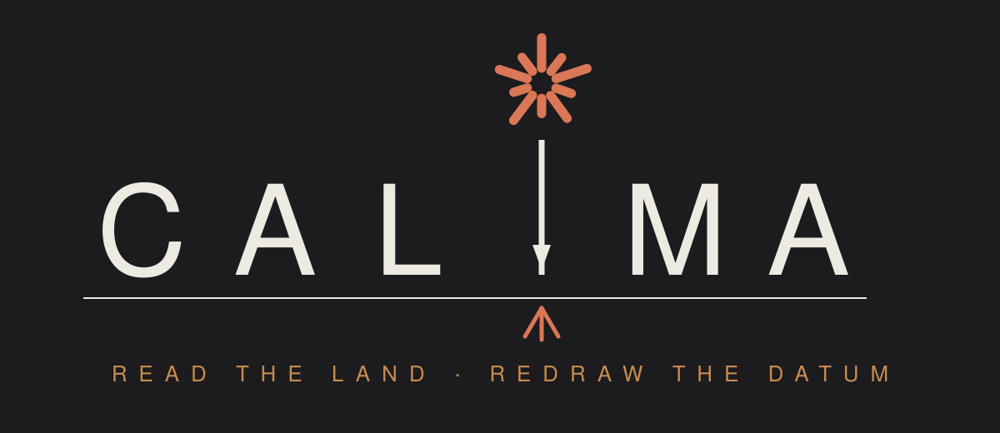
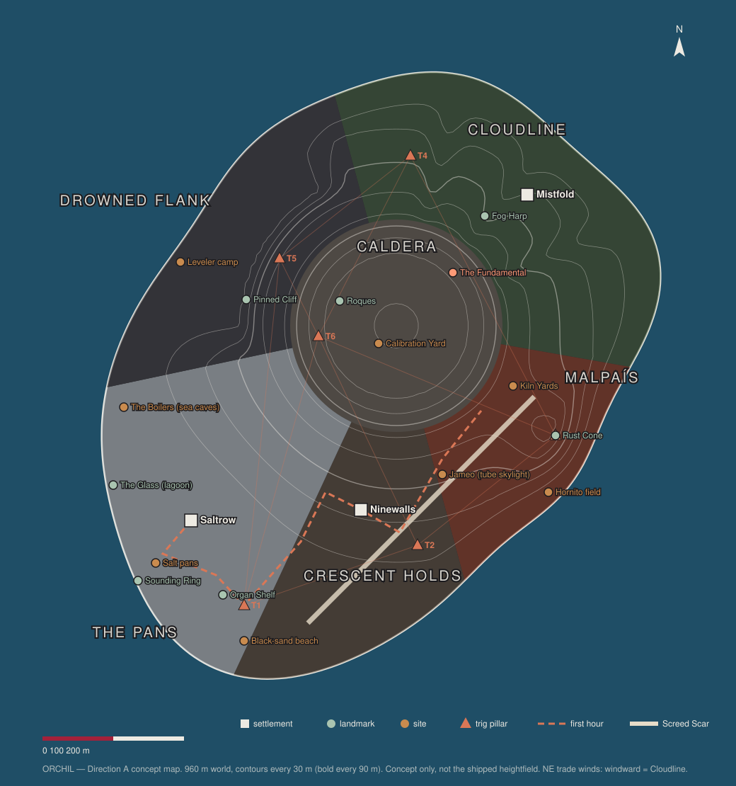
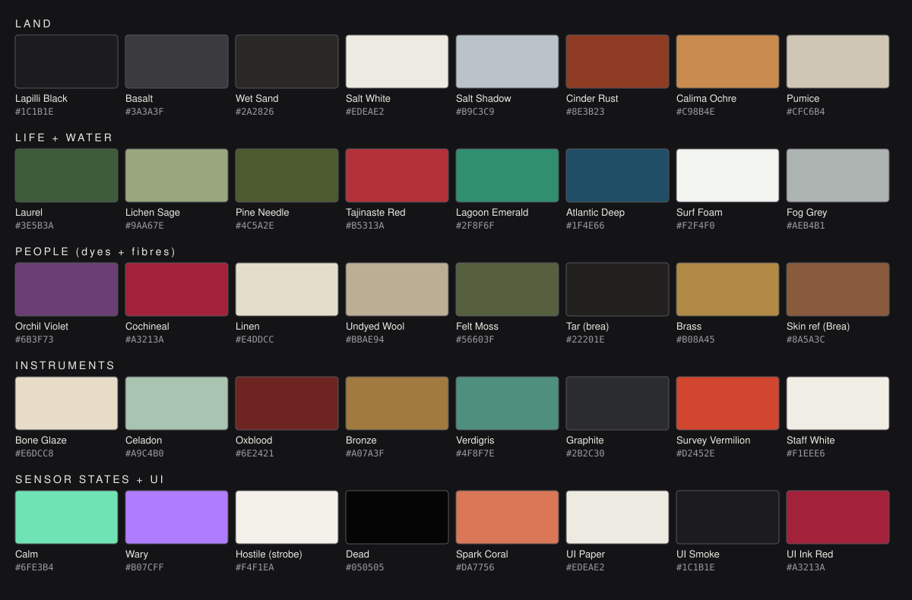

# Round 5 — Creative Direction A (place-first): **CALIMA**

Owner: Creative Director A, Round 5, Oct 15 2026. Status: proposal for Kevin's pick.
Built on: `round5-pipeline-humans.md`, `round5-pipeline-creatures-world.md`, `ROUND5-INVENTORY.md`.
Nothing in `src/` was changed. New files: this doc, `docs/media/r5-direction-a/*.svg`, and
`tools/r5-poc/direction-a/` (map, logo and palette generators, plus the name lint). All of
them are deterministic, so `python3 tools/r5-poc/direction-a/{mapgen,art,namecheck}.py`
rebuilds or re-checks them.

**Method.** Start from one place and let it decide everything else. The place is a volcanic
Atlantic island modelled on the Canary Islands. Its trade wind, salt, ash, fog and dust decide
the climate, light, materials and crafts. Those decide the people, and the people decide the
heroine, her weapons and her armor. The machines come from the place too: the island was
surveyed and pinned in place, and the machines are the survey.

| § | contents |
|---|---|
| 0 | the pitch on one screen |
| 1 | title, premise, location, era, climate, time-of-day palette |
| 2 | the protagonist: Brea |
| 3 | armor: 4 sets × 3 variants |
| 4 | weapons: 6 × 3 variants, with the poses each one needs |
| 5 | humans: 3 factions, 1 antagonist sect, 13 NPC archetypes |
| 6 | enemies: 12 Instruments, their origin and design language, and the first 4 to build |
| 7 | map: the island of Orchil, 6 biomes, sites, settlements, traversal, the first hour |
| 8 | art direction: palette, materials, light, sky, water, foliage, UI, logo |
| 9 | distinctiveness: Horizon vs Calima, and the name lint |
| 10 | production: budgets, the 3 riskiest assets, build order, what the kept stack must grow |

---

## 0. The pitch on one screen



> **CALIMA.** On a volcanic Atlantic island, survey machines are still holding the ground to an
> 800-year-old map, and they flatten anything that isn't on it. A salt-pan Reckoner has to
> survey the island again, villages included, before its western flank slides into the sea.

**Three pillars**

1. **Instruments, not animals.** Every enemy is a working survey or civil-engineering tool:
   theodolite tripods, soil samplers, a road grader, a pottery kiln, tide gauges and a cable layer.
   None has a jaw or a tail. Their family mark is the red-and-white graduation of a levelling staff.
2. **Salt, ash and fog: one island, three climates, all from one wind.** The NE trade wind leaves
   the windward north wet: cloud forest, fog nets and whistled speech. The leeward south is dry:
   black sand, salt pans, ash vineyards, live lava. When the *calima* (Saharan dust) blows in,
   the sky turns ochre and the Instruments go half-blind.
3. **Brea is a tradeswoman, not a chosen one.** She is 31, numerate and respected. Her job is
   reading the machines' marks. Her power is a brass sighting lens and a working knowledge of
   triangles. Nothing about her birth is special.

**What we keep, as the brief asks:** the rig and movement stack, unchanged in algorithm. That
covers the Retargeter, ClipLibrary, PlayerAnimator overlays, springs, controller, camera,
autorig and GaitController, engine and terrain API.

**What we add to that stack:** a rig profile (already prototyped), re-derived bow and melee
constants, and a short list of small extensions (§10.5). Every one is costed and gated, and
each of the risky ones (roll, flight, segmented train, the leap, the net) can be cut without
collapsing the direction.

---

## 1. Title, premise, setting

### 1.1 Title: **CALIMA**

- **Why drop "Horizon Zero Claude":** "Horizon" and "Zero Dawn" are Sony trademarks, and the
  brief is to stop looking like a Horizon game.
- **What the word means:** *calima* is the Canary Islands' word for Saharan dust haze. When it
  comes, the sky goes ochre and the sun becomes a soft coral disc you can look straight at.
- **How the Claude spark carries over:** that dust-sun *is* the Claude spark (#DA7756), so the
  Round 3 mark carries over with a new in-world meaning.
- **What it means in play:** calima is a weather state. Dust halves the Instruments' perception,
  and people move under it. The title is the stealth mechanic and the light at the same time.
- **Trademark check:** a web search on Oct 15 2026 found no video game titled exactly "Calima"
  (near misses: *Calico*, *CALME on the Cliffe*). Run a USPTO/EUIPO class-9/41 search before
  any public release.
- **Fallback titles, in order:** **DATUM**, **SALT & SPARK**.
- **Spark mark rules:** the 10-ray spark from `public/favicon.svg` stays pixel-identical as the
  favicon. Only its comment changes, from "rising machine-dawn" to "the calima sun". The logo
  treatment is in §8.8.

### 1.2 Premise and the one piece of lore everything hangs on

**The Datum.**

- **The threat.** About 800 years ago, Orchil's volcano was slowly failing. Its western flank was
  creeping seaward a few centimetres a year. This is a real class of hazard: compare the La Palma
  flank-collapse hypothesis, the 2021 Cumbre Vieja eruption, and El Hierro's prehistoric
  El Golfo landslide.
- **The Survey.** The islanders and an off-island consortium commissioned the **Datum Survey**.
  It is a self-maintaining population of instruments governed by:
  - one reference model, the *Datum*: Orchil measured to the millimetre on a single day;
  - one instruction: **keep Orchil true to the Datum.**
- **Three kinds of instrument.**
  - *Measuring* instruments watch.
  - *Correcting* instruments push ground back where it belongs.
  - *Anchoring works* pin the western flank to the seabed with bronze cables.
- **Then the ships stopped coming.** The reason is mundane, not apocalyptic: the mainland's
  priorities changed, and nobody came back. There is no extinction event, no rogue AI, and no
  buried apocalypse to dig up.
- **Coexistence.** For eight centuries the islanders and the **Instruments** (the in-world word;
  nobody says "machines") lived together. The Instruments ignore people. The Pan Houses read the
  Instruments' marks and keep out of their transects.
- **Epoch 812, the game's year.** The volcano wakes and the island drifts from the Datum faster
  than ever. The correcting Instruments multiply their work, and everything built *after* the
  Datum counts as error: every village, wall and salt pan.
- **Brea's arc.** Brea learns how geodesy works. The Datum accepts new observations when enough
  independent benchmarks agree (real least-squares adjustment, made into play). So she can
  **re-observe the island**:
  - climb trig pillars;
  - re-survey benchmarks;
  - make the Datum treat each village as true ground.
- **The final question.** It is at the master benchmark, the **Fundamental**. A careless new
  Datum would release the flank anchors. She has to set a Datum that keeps the island pinned and
  the people on it.
- **The theme:** the map versus the territory, and who gets to say what is true ground.

### 1.3 Location: **Orchil**, a fictional island in Macaronesia

- **Where it is:** open Atlantic water at the latitude of the Canaries (about 28° N), close
  enough to Africa that the calima reaches it.
- **Why it isn't in Horizon:** every Horizon game is set in the western USA, plus the Carja
  highlands. The Atlantic islands are untouched.
- **What the name means:** the island is named for *orchil*, the violet lichen dye that grew on
  its sea cliffs and was its first export. Orchil (*orchilla*) was a real Canary export.
- **The zero meridian:** Ptolemy put the zero of longitude at the Fortunate Isles, and in 1634
  France fixed the prime meridian through El Hierro. So the island that was once the zero of the
  world's map is where a survey still holds the ground in place. That is the thematic spine.

Every feature below is a **reference, not a reproduction**. The game uses no real place names
(except the generic geology word *malpaís*), depicts no Guanche people, and uses no sacred sites
or their names (no Tindaya, Garoé or Echeyde). Living traditions — whistled speech, the
shepherd's leap and crescent walls — are re-imagined for an invented future people and given
invented names.

| game feature | real-world reference | biome |
|---|---|---|
| salt pans beside a black-sand beach and a lagoon | Salinas de Janubio and Playa de Janubio, Lanzarote | The Pans |
| an emerald lagoon under a half-eroded red crater | El Golfo / Charco de los Clicos, Lanzarote | The Pans |
| an organ-pipe cliff of hexagonal basalt | Los Órganos, La Gomera | The Pans |
| vines in black-ash pits, each behind a crescent stone wall | La Geria, Lanzarote | Crescent Holds |
| cochineal farmed on prickly pear | Guatiza and Mala, Lanzarote | Crescent Holds |
| a village hall inside a lava tube with a skylight | Jameos del Agua and Cueva de los Verdes, Lanzarote | Crescent Holds |
| one giant dragon tree | the Drago Milenario, Icod (Tenerife) | Crescent Holds |
| live lava fields, cinder cones, surface geothermal heat, spatter chimneys | Timanfaya / Montañas del Fuego, Lanzarote | Malpaís |
| laurel cloud forest, moss, deep ravines | Garajonay (La Gomera) laurisilva, the barrancos | Cloudline |
| fog-collecting nets and a whistled language across ravines | El Hierro's fog-tree tradition; La Gomera's whistled language (UNESCO) | Cloudline |
| pole-vaulting down ravines | the Canarian *salto del pastor* | Cloudline (traversal) |
| a giant landslide amphitheatre, sea caves, wind-bent junipers | El Golfo (El Hierro), Los Hervideros (Lanzarote), the El Hierro sabinar | Drowned Flank |
| a pumice caldera floor, eroded pillars, 2.5 m red flower spires, a pine belt, a sea of clouds below | Las Cañadas del Teide, Roques de García, *tajinaste rojo*, Canarian pine (Tenerife) | Caldera |
| white cylindrical trig pillars on summits | Spain's *vértices geodésicos* | island-wide (map reveal) |

### 1.4 Era

**Epoch 812 of the Datum**, roughly the 29th century CE.

- **Technology level:** pre-industrial craft at a high standard, done by literate people. They
  have bronze casting from salvaged Instrument alloy, ceramics, dyeing, rope-making and boats.
  They keep paper field books.
- **No tribal mythology of the old world:** people know what a theodolite is. The old world is
  history, not religion. This is a deliberate break from Horizon's "tribes misread the Old
  Ones".

### 1.5 Climate

- **Classification:** subtropical oceanic, 17–27 °C.
- **Trade wind:** blows from the NE, bearing **045**. It is consistent, so foliage leans to
  the SW, crescent walls face NE, and flags stream SW.
- **Inversion:** the trade-wind inversion parks a cloud deck at 110–150 m on the windward
  (N/E) slopes. From the caldera you look down onto a sea of clouds.
- **Windward vs leeward:** the windward side is wet and green; the leeward side is dry, sunny
  and black.
- **Weather states** (extending `environment.js`'s weather machinery):

| state | frequency | what it does |
|---|---|---|
| **Trade clear** | default | normal light |
| **Calima** | 1 in 4 days, mostly over the Holds and Pans | fog colour Calima Ochre, density ×4, sun drawn as a coral disc, shadow strength 0.45, Instrument perception ×0.5 |
| **Fog bank** | Cloudline only, dawn and evening | height fog below 150 m, density ×3 |
| **Vent smoke** | local to the Malpaís | — |
| **Atlantic squall** | rare | rain on the windward side only |

### 1.6 Time-of-day palette

These are keyframes for `environment.js`'s hour table. Its sun rises at 06:00 (ENE) and sets
at 19:30 (WNW), so they drop into the existing interpolation.

| hour | sky zenith | horizon | sun / key | fog | notes |
|---|---|---|---|---|---|
| 05:30 pre-dawn | `#2B3550` | `#9C8FA0` | — | `#6F7480` | lamps on in Saltrow; the sea is darker than the sky |
| 07:00 dawn | `#6E88A8` | `#F2B98E` | `#FFC9A0`, low ENE | `#C9B3A6` | the cloud sea lit from below (`#F6D2B0`); long cool shadows (`#4A5570`) |
| 12:00 trade noon | `#3F78B5` | `#BFD3E0` | `#FFF6E8`, high | `#CFD8DE`, thin | black sand drinks light, salt glares; −0.3 EV in the Pans |
| any hour, **calima** | `#B9875C` | `#D2A274` | **sun disc `#F2A27E`** (the spark) | `#C98B4E`, ×4 | soft shadows, flat ochre; the title shot |
| 18:45 golden | `#5A6E9A` | `#F08A5A` | `#FFB070` | `#D9A37E` | rakes the basalt columns and the Drowned Flank wall |
| 19:45 dusk | `#2F3560` | `#C46A7A` (violet-rose) | — | `#7A6474` | Malpaís vents glow `#FF6A2A`; sensor lamps read |
| 23:00 night | `#0D1220` | `#1B2438` | moon `#9FB3D6` at 0.12 | `#20283A` | salt pans glow under the moon; stars; Instrument lamps are the only colour |

---

## 2. Protagonist: **Brea**

| | |
|---|---|
| name | **Brea** (BRAY-ah). *Brea* is the coast word for pitch, the tar that seals salt-pan sluices and boats. It is a nickname she earned with permanently black hands. Her real name is a whistled phrase from her mother's highland people. Name lint: clean (§9.2) |
| age | 31 (Aloy is about 19) |
| culture | born in **Saltrow** (the Pan Houses) to a Fogcatcher mother, so she whistles; she belongs to both coast and highland, not outcast from either |
| job | the Pan Houses' **Reckoner**: the guild officer who reads Instrument marks and transects, moves the pans when the Instruments' lines shift, and bargains with the tide clock. Respected and a little feared |
| temperament | dry and patient; she measures before she acts and talks in quantities ("forty paces, two hands of wind"). Competent, not chosen |
| tool | the **Alidade**: a 6 cm brass sighting tube with stadia hairlines, hung on a cord at the sternum. She raises it to her right eye to read an Instrument's job, its weak points, a bearing or a distance. It is analogue, held in the hand and away from the temple, so it is the opposite of a Focus |
| mark | a tattooed **∴** (the triangulation mark, three dots) on the back of her **right** hand. It is visible in every bow-draw close-up, because the draw hand sits at her cheek |

### 2.1 Telling her from Aloy at a glance

1. **The head:** a **violet headwrap and topknot**, with a long cloth tail trailing to the left
   rear, over black coiled hair. No red hair and no braids.
2. **The colours:** **salt-white linen and violet**, not brown leather, fur and orange.
3. **A tall vertical line:** her **lance stows upright** on her back, blade 40 cm above her
   crown. She reads like a walking survey rod at 100 m.
4. **The left forearm:** a **crescent-fan bracer**, her folded shield (§4.4). No other
   heroine carries one.
5. **An adult face:** sun creases, a white salt-paste line across the nose and cheeks (glare
   protection, worn like eye-black), and no freckles.

### 2.2 Silhouette, from three sides

- **Front.** Violet wrap band. A white smock cinched by a black girdle, with a carmine sash
  knotted at the left hip. The lance tip shows above her left shoulder. The closed fan sits on the
  left forearm. The alidade glints at the sternum. She wears wide grey trousers and rope-soled
  wrapped boots.
- **Side.** The lance runs as one vertical line from behind the knee to 0.4 m above the head.
  The topknot makes a bump at the crown-back and the wrap tail falls behind it. The hip quiver
  angles forward on the right. The pot rack and net bundle sit at the small of the back.
- **Back.** Lance upright, left of the spine. Bow diagonal beneath it (right shoulder to left
  hip). The wrap tail runs down the left of the spine. Pots and net at the lumbar.

### 2.3 Body and proportions

- **Base:** the UBC female Superhero body (CC0), normalised to **1.72 m**. This is the height
  the pipeline proof used, so every absolute-metre constant compares like for like.
- **No per-bone rescaling in v1.** Her arm is 0.475 m, and every bow and melee constant is
  re-derived on exactly this skeleton. If Kevin wants her taller, scale uniformly at normalise
  time and re-run the bow solve. Never scale individual bones.
- **How she reads strong:** the athletic base already reads as a salt-raker who hauls baskets.
  The outfit adds shoulder width (capelet in variant II) and waist definition (girdle and sash).

### 2.4 Face (no Blender)

The stock UBC face is shared with other games that use the pack. The build gives her an
identity of her own in three node-only steps inside `build-human.mjs`.

**1. Face displacement field.** Apply one smooth field (sum of Gaussian bumps in bind space)
to every head-attached mesh **with the same field**, so they stay registered: body head
vertices, brows, eye mesh and hair shell.

| landmark | change |
|---|---|
| nose bridge | +3 mm higher |
| nose length | +4 mm |
| cheekbones | +3 mm lateral, +2 mm forward |
| jaw angle | +4 mm wider |
| brow ridge | +2 mm forward |
| chin | +2 mm forward |
| upper lip | −1 mm |

- **Rules:** the eye socket stays rigid (radius 18 mm falloff mask) so the eye mesh never
  floats. Normals are recomputed after the displacement.
- **Gate:** see *V-brea-face* in §10.4.

**2. Paint layer.** Composited onto the base colour with `sharp`:

- warm olive-brown skin, reference `#8A5A3C` at mid-cheek in sRGB;
- sun creases at the eye corners;
- the salt-line: off-white `#EDEAE2` paste, 8 mm wide, from cheek to cheek across the nose
  bridge, with a slight crackle;
- a 3 cm scar through the left eyebrow;
- the ∴ on the right hand;
- darker lips;
- no freckles.

**3. Eyes and brows.** Dark brown eyes (UBC `T_Eye_Brown`, darkened to `#3B2A20`). Heavy
straight brows (brow mesh scaled 1.08 in thickness).

**Fallback:** if V-brea-face fails twice, install Blender for a sculpt pass only:
`brew install --cask blender`, a 346 MB DMG and about 1.2 GB installed. Measured in the humans
pipeline doc.

### 2.5 Hair, wrap and the moving chains

| part | build | chain | rest pose and routing |
|---|---|---|---|
| short coils | UBC `Hair_BuzzedFemale` shell, tinted `#15110F` | — | rigid on `Head` |
| topknot | procedural wrapped bun, 14 cm diameter, ≤ 400 tris | — | rigid on `Head`, crown-back |
| loose curl tail | procedural lofted tube, 0.22 m, ≤ 500 tris | `dyn_hairKnotTail_01..04` + `_end`, class **hair** (this is the A33-hair-bounce target) | falls from the knot to the nape |
| headwrap band | procedural, 6 cm wide, wrapped at the hairline, Orchil Violet, ≤ 900 tris | — | rigid on `Head` |
| **wrap tail** | procedural cloth strip, 0.50 m × 7 cm, ≤ 700 tris | `dyn_wrapTail_01..06` + `_end`, class **cloth** (the regex already matches *Sash/Flap/Rope*; name it `dyn_wrapSash_*` if the cloth parameters are wanted) | from the knot down the **left** of the spine. The right-cheek bow anchor never shares space with it |
| alidade cord | 2 links | `dyn_alidadeCord_01..02` (falls through to cloth) | sternum |

- **Bow-draw rule:** draw hand at the cheek, outside the hair. The topknot is high and the tail
  hangs on the left, so the anchor at the right cheek is clear.
- **The M10 spring collider:** a capsule on the right hand and forearm, added to the spring
  solver. It is the one new physics piece and replaces the Aloy-specific braid guard.

### 2.6 Default outfit: *Pan Whites I* ("Raker's Whites")

| slot | source | retexture (the `pan` atlas, 1024² base/normal/ORM) | tris |
|---|---|---|---|
| torso | MCO `Female_Peasant_Body` (CC0) | white linen weave; corset becomes a black lapilli-dyed leather girdle; orchil hem band | ≈ 5 k |
| arms | MCO `Female_Peasant_Arms` | linen sleeves painted rolled to the elbow; leather finger-tab on the right | ≈ 2.5 k |
| legs | MCO `Female_Peasant_Legs` | basalt-grey wide trousers | ≈ 2.5 k |
| feet | MCO `Female_Ranger_Feet` | rope-soled boots wrapped in esparto cord | ≈ 3 k |
| waist | procedural carmine sash with a hanging end (`dyn_sashEnd_01..04`, cloth) | carmine `#A3213A` | ≤ 900 |
| head | §2.5 | — | ≤ 2.5 k |
| left forearm | the closed Windwall (§4.4), always present | — | (weapon) |
| **total** | body cut at head and neck + outfit + hair | | **≈ 36 k tris, 4 draws** (skin/head, outfit atlas, hair+wrap, eyes) |

**Colour proportions:**

| colour | hex | share |
|---|---|---|
| Salt White | `#EDEAE2` | 45 % |
| Basalt / Lapilli | `#3A3A3F` / `#1C1B1E` | 25 % |
| Orchil Violet | `#6B3F73` | 15 % |
| Cochineal Carmine | `#A3213A` | 7 % |
| skin | — | 5 % |
| Brass | `#B08A45` | 3 % |

### 2.7 Carry layout (stow sockets)

Every stowed item is authored **from the body surface**: the offset is measured from the
nearest body vertices along their normal, not typed as char-space metres. That is what fixes the
proof's 0.2 m floating spear.

| item | socket bone | placement | constraint |
|---|---|---|---|
| lance | `spine_03` | **vertical**, 0.09 m left of the spine midline, ferrule at about knee height, blade 0.40 m above the crown | gap to back ≤ 0.03 m; never crosses the wrap tail (tail is outboard-left of it) |
| bow | `spine_02` | diagonal on the back, right shoulder to left hip, under the lance | gap ≤ 0.03 m |
| quiver (cane tube, 12 arrows) | `pelvis`, right hip | tilted **20° forward** so the nock hand never goes behind the shoulder plane | |
| gaff | `pelvis`, left hip | hook over the belt, head up | |
| pots ×3 + net bundle | `pelvis`, lumbar | pots left-lumbar, net centre-lumbar | clear of the left forearm's sprint swing |
| windwall (closed) | `lowerarm_l` | dorsal (outer) side of the forearm | clear of the bowstring path |
| alidade | neck cord | sternum | — |

- **Draw-call trick:** all stowed gear is **one merged mesh, one draw**, on one 1024² weapon
  atlas, rigid-skinned to the bones above.
- **Hiding a drawn weapon's stowed copy:** a per-vertex `pieceId` and a uniform bitmask collapse
  that piece to zero in the vertex shader. It still costs one draw.
- **Per-frame cost:** the in-hand weapon is 1–2 draws, arrows are instanced (1). **Gear total
  ≤ 4 draws**, against the 65 meshes inherited today.

### 2.8 What she needs from the movement stack

| action | source | status | Kevin's rule it must meet |
|---|---|---|---|
| idle, walk, jog, run, sprint, crouch | kept locomotion + overlays | **carried over, measured** (proof: arms fore-aft, no crossing) | idle hands fine; running arms beside the body, never T-rex, never prancing |
| bow nock, draw, hold, release | kept bow/aim overlays, **about 12 constants re-derived** on the 0.475 m arm | re-tune (proof: 141° bow arm, elbow 9 cm low) | bow arm 165–172° (A35), draw hand at the cheek 0.10–0.16 m from the head and outside the hair, elbow level or back, bow arm clear of the chest, never an arm behind the head |
| lance ready, thrust, sweep, butt-strike | kept `meleeLayer`, **tables re-measured** | re-tune | melee performed by the body (hip → shoulder drive), both hands on the shaft |
| lance throw, pots, net | UAL2 `OverhandThrow` (native on UBC) | new clip, no retarget | throwing hand passes **beside**, not behind, the head (clamp overlay if the clip's wind-up crosses) |
| gaff combo, hook-rip, lunge | UAL2 `Sword_Regular_A/B/C(+_Rec)`, `Sword_Regular_Combo`, `Melee_Hook`, `Sword_Dash`; UAL1 `Sword_Idle` | new clips, native, **body-performed by construction** | weapon socketed to `hand_r` with the hook edge forward |
| windwall guard, parry, bash, break | UAL2 `Idle_Shield_Loop`, `Sword_Block`, `Shield_Dash`, `Shield_OneShot`, `Idle_Shield_Break` | new clips, native | shield on the left forearm, body turns into the block |
| alidade raise | new overlay: right hand to the right eye, reusing the bow-anchor IK target | extension E12 (½ day) | elbow down and in, never above the head |
| climb, slide, swim | UAL2 `ClimbUp_1m`, `Slide_Start/Loop/Exit`; UAL1 `Swim_*` | new clips | — |
| heal (drink from a fog-water gourd) | UAL2 `Consume` | new clip | — |
| rake, interact, pick up | UAL2 `Farm_Harvest`; UAL1 `Interact`, `PickUp_Table` | new clips | — |
| pole-vault ("leap") | new traversal state | **extension E9, cut line** (§10.5) | — |

---

## 3. Armor: 4 sets × 3 variants

### 3.1 The system

**Slots:** HEAD, SHOULDERS, TORSO, ARMS, WAIST, LEGS, FEET.

**What each piece is:** a SkinnedMesh bound to the one 65-joint skeleton by joint name, keeping
its own inverse binds. Pieces come from two places:

- CC0 MCO parts (Peasant/Ranger Body, Arms, Legs, Feet, Hood, Pauldrons), **retextured** into a
  per-set atlas;
- **procedural pieces** generated in node and rigid-weighted to 1–2 joints. They sit flush
  because their surface is offset from body vertices along the normal.

**Per set:**

- one 1024² atlas (base, normal, ORM), shared by its 3 variants;
- variants toggle pieces (hidden costs 0 draws) and swap masks and tints;
- **≤ 2 merged draws plus toggles; protagonist total ≤ 5 draws, ≤ 40 k tris**;
- each procedural piece ≤ 3 k tris.

**Swap rules:**

- dispose geometry, materials, every texture slot and the mesh's **Skeleton** (the proof's
  one-bone-texture-per-swap leak);
- drop the fade-clone bookkeeping;
- gate: *A-outfit-swap-memory* (geometries and textures equal after 6 swaps).

**Stats** map onto the existing `progression` armor multiplier and the element channels
(Cinder = `fire`, Brine = `freeze`, Dust = `shock`; §4.7).

| field | range |
|---|---|
| `armor` | 0–0.35 |
| `resist{cinder,brine,dust}` | 0–0.6 |
| `noise` | ×0.75–1.15, feeds `stampStealthDisc` / `NOISE` |
| `stamina` | traversal cost multiplier |
| one perk | — |

The closed **Windwall** is on the left forearm in every set. Its look changes with the Windwall
variant, not with the armor.

### 3.2 Set A — **Pan Whites** (Saltrow; brine and economy)

Atlas `pan`: linen weave, salt-crust mask, orchil and carmine trims, palm weave, brass.

| variant | what changes on screen | pieces added (source) | stats |
|---|---|---|---|
| **I Raker's Whites** (default) | white smock, carmine sash, violet wrap, esparto boots | §2.6 | armor .05 · brine .20 · stamina regen +10 % |
| **II Guild Whites** | + a woven-palm **wide hat** (0.42 m brim) that **flips to a back socket in combat** (two hidden meshes, 0 extra draws), + an orchil capelet with a brass guild clasp | hat ≤ 600 (proc, `Head` / `spine_03`); capelet ≤ 1.8 k (proc, clavicles + `spine_03`) | armor .10 · immune to salt glare-blind in the Pans · +15 % salt from raking and sales |
| **III Brine-Cured** | linen stiffened with a salt-crystal crust on hems and shoulders; **celadon ceramic shoulder scutes** cut from Gauge floats; crusted shin guards | `Female_Ranger_Acc_Pauldrons` retextured as ceramic; shin scutes ≤ 1.2 k (proc) | armor .20 · brine .50 · noise ×1.10 (the crust crackles) |

### 3.3 Set B — **Ash Wraps** (Crescent Holds; stealth and dust)

Atlas `ash`: black and rust wool, undyed wraps, leather, smoked mica.

| variant | what changes on screen | pieces added | stats |
|---|---|---|---|
| **I Pit Wraps** | layered **black wool wrap-tunic** over a rust under-layer, puttee leg wraps, felt-soled boots | `Ranger_Body` and `Peasant_Arms` retextured; puttees ≤ 1.5 k (proc); `Peasant_Feet` retextured | armor .08 · **noise ×0.75 on ash, lapilli and sand** · dust .20 |
| **II Calima Veil** | + rust **face veil** over nose and mouth; + **smoked mica goggles** worn up on the brow, dropped over the eyes when calima blows (two sockets); hood up | `Ranger_Head_Hood` retextured; veil ≤ 500; goggles ≤ 300 | armor .10 · dust .60 · in calima the alidade outlines Instruments through the dust |
| **III Lattice Quilt** | + a quilted vest stitched in the **crescent-wall pattern**, faced with knapped basalt-flake lamellae; a crescent bronze gorget | vest ≤ 2.5 k (proc, `spine_01..03`); gorget ≤ 600 | armor .25 · knockdown resist +40 % · noise ×0.9 |

### 3.4 Set C — **Fog Felts** (Fogcatchers; traversal and wet)

Atlas `fog`: felted wool in laurel and moss, sheepskin, net mesh, goat horn.

| variant | what changes on screen | pieces added | stats |
|---|---|---|---|
| **I Shepherd's Felt** | moss-green felted tunic, sheepskin over-vest, horn toggles, laced boots | full Ranger set retextured as felt; vest ≤ 1.5 k | armor .08 · climb, slide and leap stamina ×0.8 · fall damage −50 % |
| **II Dripline** | + a **fog-net shawl**: opaque lattice geometry with no alpha, strung with water beads; its two back points swing | shawl ≤ 2 k with `dyn_shawlFlap_l/r_01..03` (cloth) | armor .10 · cinder .40 (wet felt) · slow health regen in fog and rain |
| **III Highline** | + felt hood, goat-horn shoulder toggles, a rope coil worn cross-body | `Ranger_Head_Hood` retextured; rope coil ≤ 800 | armor .15 · whistle range ×2 (pings benchmarks, calls Fogcatcher scouts) · shows each Instrument's wary radius in the alidade |

### 3.5 Set D — **Glaze Plate** (salvaged Instruments; the heavy set)

Atlas `glaze`: ceramic tiles laced with bronze wire over linen. This is **ceramic lamellar**,
deliberately not "machine hide".

| variant | what changes on screen | pieces added | stats |
|---|---|---|---|
| **I Celadon Lamellar** | rows of celadon tiles laced with bronze wire over the smock; a tiled right bracer | lamellar ≤ 3 k; each **tile row is rigid to one bone** (`pelvis`, `spine_01/02/03`), so bending opens real gaps; `Ranger_Arms` + tile bracer | armor .30 · impact −15 % · noise ×1.15 |
| **II Oxblood Lamellar** | oxblood tiles, ceramic pauldrons, glazed shin plates | `Ranger_Acc_Pauldrons` as ceramic; shins ≤ 1.2 k | armor .32 · cinder .50 |
| **III Datum Plate** | bone-white tiles with **brass graduations**, and a salvaged Instrument lens set at the sternum that glows calm green | sternum lens ≤ 400 (emissive, no shadow) | armor .35 · **Instruments perceive her ×0.7 while she walks or stands still**, because they read her as one of their own (hostile ones aren't fooled). The final-act set |

---

## 4. Weapons: 6 weapons × 3 variants

### 4.1 The contract

All six keep the existing model contract:

```
{ group, model, pull, restZ, setDraw(d, showAmmo), setArrowType(id), getNockWorld(d, out) }
buildWeaponModel(id), buildSpear()
```

They move from runtime procedural code to **node-baked GLBs**:

- merged per material, **1–2 draws** each;
- one shared 1024² weapon atlas;
- named sockets: `grip`, `grip2`, `nock`, `string_top`, `string_bottom`, `tip`, `stow`, `hook`;
- authored at real length, which retires `SPEAR_SCALE 0.80`.

A variant is **data** (length, curve, palette, head type, attachments), not a separate import.
Budget per weapon: ≤ 3 k tris (lance ≤ 1.5 k) and ≤ 0.15 MB.

### 4.2 Bows (kept): the **juniper family**

| variant | silhouette and materials | role and numbers |
|---|---|---|
| **Sabina Bow** | 1.45 m self-bow of **wind-twisted juniper**: pale sapwood face, dark heartwood back stripe, slight natural reflex, esparto-wrapped grip, horn nocks | all-round. Draw 0.65 s, damage ×1.0 |
| **Cane Recurve** | 1.15 m, laminated giant cane + goat horn + **bronze recurved tips** (static siyahs), carmine silk wraps | fast and quiet. Draw 0.45 s, damage ×0.8, noise ×0.7 |
| **Sighting Bow** | 1.60 m longbow of resin-dark pine with a **bronze sight vane** (alidade fin) and a small lens on the riser | precision. Hold to steady (×2 zoom); weak-point damage ×1.5; draw 0.9 s |

**Arrows:** cane shafts with gull-feather fletching (white and black), bronze or obsidian heads.

| ammo | effect |
|---|---|
| Reed | impact |
| Barbed | tear |
| Brine-Gourd | brine |
| Cinder-Resin | cinder |
| Dust-Puff | dust |

**Poses:**

- **Hold:** bow in the left hand, vertical, tip down.
- **Nock:** right hand to the forward-tilted hip quiver, staying below the shoulder.
- **Draw:**
  - bow arm locked at 165–172°;
  - draw hand at the **right jaw corner**, 0.10–0.16 m from the head, outside the knot and tail;
  - draw elbow at shoulder height or behind it (≥ −0.02 m);
  - bow arm clear of the chest by ≥ 0.04 m;
  - the closed fan on the bow forearm sits on the dorsal side, so the string clears it.
- **Release:** the hand travels 8–12 cm back along the jaw.
- **Stow:** back diagonal (§2.7).
- **Gates:** A35 plus V-bow-anchor-brea.

### 4.3 Lances (kept): the **shepherd's family**

| variant | silhouette and materials | role |
|---|---|---|
| **Shepherd's Lance** | 2.10 m resin-dark pine pole, 22 cm bronze leaf blade, **bronze ferrule** at the butt, esparto grip wraps at both hand positions | balanced reach melee. The leap (E9) uses it if E9 ships |
| **Obsidian Lance** | the same pole with a 30 cm **knapped obsidian blade** bound in sinew and resin | tear specialist: component damage ×1.6, impact ×0.8 |
| **Counterweight Lance** | 2.0 m pole with a cast **bronze plumb-bob counterweight** at the butt (taken from a Plumb) and a broader blade | heavy: knockdowns, a butt-strike finisher, slower. The heavy string uses UAL2 `Sword_Heavy_Combo` if it reads two-handed (verify by eye before committing) |

**Poses:**

- **Ready:** two-handed. The left hand sits at 55 % of the shaft from the butt and the right at
  20 %; the blade points forward and up 15°.
- **Thrust:** hip-driven; the rear foot pushes and the shoulders follow the hips.
- **Sweep, butt-strike.**
- **Throw:** `OverhandThrow`. The lance stays in the world until picked up.
- **Stow:** upright on the back (§2.7).
- **Rule:** both hands stay on the shaft except during the throw.

### 4.4 **Windwall** (new): the crescent fan-shield

The shape comes from the La Geria crescent wall: a windbreak you carry.

- **Closed:** a 0.42 m bundle of 9 slats strapped along the dorsal left forearm. It doubles as
  the archer's bracer.
- **Open:** the slats pivot from a wrist hub into a **110° crescent fan**, 0.9 m chord by
  0.55 m deep, with goat hide stretched between them.
- **Rig:** 9 slat bones `fan_00..08` under `hand_l`, driven by **one `open` parameter (0–1)**.
  It is deliberately **not** `dyn_`, so the springs never touch it. Extension E10, ½ day.
- **Budget:** ≤ 2.5 k tris, 1 draw.

| variant | look | numbers |
|---|---|---|
| **Pine Windwall** | pale pine slats, ochre hide | opens in 0.18 s; parry window 0.25 s; blocks 40 % of heavy hits |
| **Scute Windwall** | each slat riveted with a Tiller's bone-glaze scute | opens in 0.28 s; blocks 80 %; guard breaks later |
| **Mirror Windwall** | polished brass boss and mirror rim | a perfect parry **reflects Plumb sightlines and Transit beams**, blinding the source for 4 s |

**Verbs:**

| verb | clip |
|---|---|
| guard | `Idle_Shield_Loop` |
| parry | `Sword_Block` |
| bash | `Shield_Dash` |
| absorb | `Shield_OneShot` |
| guard-break stagger | `Idle_Shield_Break` |
| **plant** | `Crouch_Idle_Loop` |

Planting drives the fan into the ground as a 0.9 m crescent of cover that blocks Instrument
line of sight. It pairs with the gaff, or stands alone with the bow (plant, then shoot from
cover).

### 4.5 **Gaff** (new): the fisherman's hook-blade

| variant | silhouette and materials | role |
|---|---|---|
| **Boat Gaff** | 0.75 m laurel haft, forged bronze hook with a 12 cm back-blade, carmine grip wrap | fast 3-hit combo. **Hook-rip** pulls a component off small and medium Instruments at melee range |
| **Rake Gaff** | 0.85 m; the head is a **T-shaped salt-rake comb** of bronze tines with a hook at one end | wide sweeps with knockback on Pegs and Sickles |
| **Bronze Gaff** | cast from a Screed's ram cylinder: heavy, serrated inner hook | breaks armour plates ×1.5, slower combo |

- **Clips:**
  - `Sword_Idle` for ready;
  - `Sword_Regular_A/B/C` plus `_Rec`, and `Sword_Regular_Combo`;
  - `Melee_Hook` for the rip, ending with a pull toward the body;
  - `Sword_Dash` for the lunge.
- **Hand and stow:** gripped in `hand_r` with the hook edge forward; stows on the left hip.
- **Why it is the lowest-risk melee in the game:** these are authored CC0 clips on the
  heroine's own skeleton. They play with no retarget, and the body performs every swing.

### 4.6 **Pots** (new): hand-thrown clay grenades

- **Shape:** hand-built, burnished pottery about 0.15 m across, ≤ 300 tris each.
- **Carry:** three ride in the lumbar rack. Each kind is crafted from clay plus salt, vent resin
  or pumice.
- **Throw:** `OverhandThrow`, with a quick toss at 1.25× time scale and an arc preview. The
  throwing hand stays beside the head, not behind it.

| variant | look | effect |
|---|---|---|
| **Brine Pot** | grey-green clay, wax seal, sloshes | brine mist 3 m: Instrument speed −40 %, armor −20 % for 10 s. **Quenches Kiln fireboxes** |
| **Cinder Pot** | oxblood slip painted with carmine zig-zags; a rag fuse lit from a vent-ember tinder box | fire pool 2.5 m for 6 s |
| **Dust Pot** | pale pumice-clay, punched with holes, packed with calima dust | dust cloud 5 m for 6 s: perception −80 %, breaks lock-on, resets alert |

### 4.7 **Cast Net** (new): the fisherman's throw-net

- **Mesh:** a procedural disc of 24 radial × 6 ring segments, ≤ 1.2 k tris, 1 draw. One `open`
  parameter spreads it.
- **On contact:** the rim sinkers pin to the target's nearest bones, and the gait amplitude and
  speed are scaled down while it is fouled. Extension E11, ½ day.
- **Retrieve:** `PickUp_Table` within 3 m.
- **Carry:** one net (two with the Fog Felts perk).
- **Throw:** `OverhandThrow` at 0.9× with a wider wind-up (a spin-cast); same head rule.

| variant | build | effect |
|---|---|---|
| **Hand Net** | 2.4 m, linen cord, basalt sinkers | fouls legs on Pegs and Sickles (−60 % speed, 5 s). **Fouls a Sonde's fans, so it sinks** |
| **Sinker Net** | 3.2 m, heavy sinkers | also slows medium Instruments. **A Gyre topples** |
| **Wire Net** | bronze wire | fouls and shorts sensors (blind 3 s); Sickle blades can't cut it |

**Elements, mapped onto the existing damage channels (no new combat code):**

| element | channel | effect | strong against |
|---|---|---|---|
| **Cinder** (vent resin) | `fire` | burn over time | Sonde envelopes, Kiln canisters |
| **Brine** (corrosion) | `freeze` (slow/brittle) | bronze joints seize | bronze-heavy Instruments (Screed, Transit); also shocks a Kiln firebox |
| **Dust** (calima) | `shock` | blinding | sight-based Instruments (Plumb, Sonde) |

Rename `blaze`/`chillwater` and the rest in the term sweep (§9).

---

## 5. Humans

### 5.1 The factions

| | **Pan Houses** (coast) | **Crescent Holds** (ash lowland) | **Fogcatchers** (cloud forest) | **Levelers** (antagonist sect) |
|---|---|---|---|---|
| who | salt-making guild families; traders and boat-builders; the island's money (salt) | farmers who plant vines and figs in ash pits; cochineal growers; bronze-smiths in the lava tube | highland herders and fog-net keepers; keepers of the paper field books; whistled speech | Datum zealots who believe the island must be returned to the model, so post-Datum villages should go |
| motif | **the grid** (salt-pan cells) | **the crescent** (the zoco wall) | **the vertical** (nets, rain, poles) | **the line and the broad arrow** (benchmark ↑) |
| colours | Salt White, Orchil Violet, Cochineal Carmine, Brass | Lapilli Black, Cinder Rust, undyed wool, olive | Laurel, Felt Moss, Fog Grey, charcoal | kaolin white, survey vermilion and white bands |
| materials | linen, palm weave, brass, tar | wool, leather, mica, basalt flake | felt, sheepskin, goat horn, laurel wood, net | ceramic masks salvaged from Instrument lens housings |
| architecture | whitewashed cube houses, flat roofs, **orchil-painted wooden balconies**, wind pumps, salt cones | low drystone houses sunk into lapilli; the lava tube as hall and forge | round stone huts with sod roofs, net frames, ladders, **cable baskets** across ravines | a camp of banded tripods and pegged lines at the foot of the Pinned Cliff |
| sound | bells, rakes, surf | wind on stone, hammering in the tube | whistles across ravines, dripping nets | measured paces, called-out numbers |
| attitude to Instruments | read them and get out of the way | follow Tillers to plant in their auger holes | avoid them; know the old books | serve them, and guide Screeds to "error" |

### 5.2 How an NPC is built

- **Body:** UBC female or male, 1.64–1.84 m (an adolescent at 0.90 scale with `Head` ×1.06).
- **Clothes:** retextured MCO parts on a **faction atlas**, plus procedural faction pieces.
- **Hair:** UBC hairstyles plus beard, tinted.
- **Variety:** a **mask-aware tint shader** reads the outfits' `COLOR_0..2` masks, so each
  person gets a different dye pairing. Extension E14, ½ day.
- **Budget:** ≤ 12 k tris at LOD0 (simplify the Ranger pieces by about 50 %), ≤ 4 k at LOD1
  beyond 25 m, ≤ 2 draws each (one atlas per body type and faction; base 1024², normal and ORM
  shared at 512²). That fixes the proof's 6.5 draws per NPC.
- **Animation:** UAL2 clips play natively on UBC. UAL1 clips need either one baked ClipLibrary
  per body type or the switch to UAL v3 (humans doc §3.7).
- **Routes and states:** the existing `ctx.npcs` system (`idle · walk · goto · work · errand ·
  sit · sleep · talk`).
- **Walk style is data:** clip choice, `timeScale`, route speed, an additive posture (spine pitch
  and head pitch, applied after the mixer), an arm-swing gain (a rest-blend on the upper and lower
  arms), and stance width (a thigh-roll offset).

### 5.3 Thirteen archetypes

| # | archetype | faction | body, height, age read | outfit (atlas + parts + pieces) | hair / face | idles (existing clips) | walk style | where and when |
|---|---|---|---|---|---|---|---|---|
| 1 | **Salt Raker** | Pan | F or M, 1.66–1.78, 25–45 | `pan`: Peasant body, arms, legs + Ranger feet; palm hat; rake prop | Buzzed or Buns under the hat | `Farm_Harvest` (raking), `Consume` | `Walk_Loop` ×0.95, lean +6°, short stride | salt pans, daytime |
| 2 | **Guild Matron** | Pan | F, 1.64, 60s | `pan`, orchil-heavy; proc shawl; brass guild chain | Buns tinted grey `#9A958E`, sun-lined face paint | `Idle_FoldArms_Loop`, `Idle_Talking_Loop`, `Idle_No_Loop` | `Walk_Formal_Loop` ×0.85, upright (spine −3°), arm swing ×0.6 | Saltrow guild house |
| 3 | **Salt Porter** | Pan | M, 1.82, 22–35 | `pan`: sleeves painted rolled, carmine sash; salt basket on the shoulder (≤ 400, rigid) | Buzzed (± Beard) | `Walk_Carry_Loop`, `Consume`, `Yes` | `Walk_Carry_Loop` ×1.0 | pans to the store, all day |
| 4 | **Boat-Caulker** | Pan | M, 1.74, 45–60 | `pan` with a **tar-black hands and forearms** mask | SimpleParted grey + Beard | `Fixing_Kneeling`, `Push_Loop` | `Walk_Loop` ×0.9, wide stance (thigh roll +4°), rolling sway | boats on the black beach |
| 5 | **Lantern-Keeper** | Pan | F, 1.68, 65+ | `pan` + orchil night cloak (capelet); cane | Long, grey | `Idle_Lantern_Loop` (night), `Sitting_Idle_Loop` (day) | `Walk_Loop` ×0.75, stoop (spine +10°, head −6°) | breakwater, 19:30–05:30 |
| 6 | **Pit Farmer** | Holds | F or M, 1.66–1.80, 30–50 | `ash`: Ranger body as wool + Peasant arms; mica goggles up; basket | Buzzed or SimpleParted | `Farm_PlantSeed`, `Farm_Watering`, `Farm_Harvest` | `Walk_Loop` ×0.92 | the crescent pits |
| 7 | **Tiller-Follower** (adolescent) | Holds | F or M, scale 0.90 (1.55 m), `Head` ×1.06, about 15 | `ash`, lighter wraps; seed bag | Buns or Buzzed | `Idle_Rail_Loop` (leaning on a crescent wall), `Farm_PlantSeed` | `Jog_Fwd_Loop` when trailing a herd; `Walk_Loop` ×1.1 | behind Tiller herds |
| 8 | **Cochineal Picker** | Holds | F, 1.70, 20–35 | `ash` with a **carmine-stained** apron and gloves (mask) + headscarf | Long, tied | `PickUp_Table`, `Interact`, `Idle_Talking_Loop` | `Walk_Loop` ×1.0 | prickly-pear terraces |
| 9 | **Tube Smith** | Holds | M, 1.84, 35–50 | `ash` + leather apron (≤ 800); burn-scar skin decal | Buzzed + Beard | `TreeChopping_Loop` (a hammer prop in place of the axe), `Chest_Open` | `Walk_Loop` ×0.9, heavy (spine +3°, arm swing ×0.7) | the lava-tube forge at Ninewalls |
| 10 | **Fog-Netter** | Fogcatchers | F or M, 1.70–1.80, 20–40 | `fog`: full Ranger set in felt; net pole | SimpleParted or Buns | **`Idle_Rail_Call`** (whistling across the ravine), `Push_Loop` (hauling net), `Farm_Watering` (emptying troughs) | `Walk_Loop` ×1.05, long stride, pole in hand | Fog Harp, net arrays |
| 11 | **Goat-Herd Vaulter** | Fogcatchers | M, 1.78, 18–28 | `fog` + sheepskin vest; long pole | Buzzed | `Sitting_Idle_Loop` (on a rock), `NinjaJump_Idle_Loop` (crouched ready), `Yes` | `Jog_Fwd_Loop` ×1.0, light | ravine sides |
| 12 | **Field-Book Elder** | Fogcatchers | F, 1.64, 70+ | `fog`, dark; hood up; book prop | Long, white | `Sitting_Talking_Loop`, `Idle_No_Loop`, `Idle_Talking_Loop` | `Walk_Loop` ×0.7, stoop +12°, cane | the Mistfold archive |
| 13 | **Leveler** | antagonist | F or M, 1.70–1.84 | `level`: **kaolin-whitened skin** (tint), vermilion and white banded sash, an opaque **lens-housing mask** with one lamp (≤ 800), banded staff | hooded | `Idle_Shield_Loop` (staff guard), `Idle_FoldArms_Loop` | `Walk_Formal_Loop` ×0.9, **stride locked to exactly 0.80 m** (they pace distances) | Leveler camp, as Screed escorts |

That gives 13 archetypes × 2 bodies × 6 hairstyles × tint pairs. The A-npc-variety bar (≥ 8
distinct signatures) is met inside Saltrow alone.

---

## 6. Enemies: **the Instruments**

### 6.1 Design-language rules (they apply to every model)

1. **A tool first.** Its silhouette must be explained by one survey or civil-engineering job in
   one sentence.
2. **No heads, no jaws, no tails, no faces.** Sensors are drums, lenses, spirit vials and lamps.
3. **The family mark:** every Instrument carries at least one **graduated element**:
   vermilion-and-white staff bands (`#D2452E`/`#F1EEE6`) or brass numerals.
4. **Materials:** bone, celadon and oxblood **glaze** over **bronze**, verdigris on worn edges,
   graphite joints (palette in §8.1). No exposed "muscle", no cable sinews, no chrome.
5. **Mechanical locomotion:** tripod; hexapod in tripod or wave gait; stilts; rolling; buoyant
   drift; segmented train. **Every knee is in the sagittal plane**, so `gait.js` needs no
   per-leg pole change.
6. **Honest weak points:** a level vial, a ram seal, a bearing, a firebox door, a float tank.
   Things that would really break.
7. **Components come off as recognisable tools** (an auger bit, a plumb bob, a blade, a chimney),
   and you can use the loot.
8. **Size follows job:** small instruments *measure*, medium ones *sample and mark*, large ones
   *correct*, and the colossus *observes*.
9. **Light:** emissive only on sensors and fireboxes. Sensor states are **calm `#6FE3B4`**
   (steady), **wary `#B07CFF`** (1 Hz pulse) and **hostile `#F4F1EA`** (6 Hz strobe with the iris
   closed to a slit); dead is `#050505`. This replaces `EYE_COLORS`, the canon blue, amber and
   red. In the build:
   - lens emissive ×2.5 with a core above the bloom threshold, so it reads at noon (the proof
     found that gap);
   - sensors marked `noShadow`.
10. **Sound:** chimes, ratchets, escapements, gyroscope whine, ceramic clinks, staff-rattle. Never
    a roar.

**How they are built:** the proven path, end to end:

1. `gen-<kind>.mjs` with the hs kit (one hull material and one sensor material);
2. labels written by the generator;
3. `autorig` → `GaitController`;
4. mesh fold;
5. socket snap.

The fidelity pass from creatures doc §5.1.6 is mandatory for the first four: lathe-curved
armour, a shared decal and trim atlas carrying station numbers and graduations, and LOD1 at
about 35 %.

### 6.2 The roster at a glance

| # | name | family | role | size class | L × W × H (m) | tris / bones | locomotion | path |
|---|---|---|---|---|---|---|---|---|
| 1 | **Peg** | measure | swarm, transect layer | small | 1.1 × 0.6 × 0.9 | ≤ 8 k / 14 | quadruped trot | kept |
| 2 | **Plumb** | measure | sentry, marker | small | 2.4 × 2.4 × 3.4 | ≤ 15 k / 18 | **tripod** (offsets 0, ⅓, ⅔) | kept (any leg count) |
| 3 | **Tiller** | measure | herd grazer | medium | 4.5 × 1.8 × 2.7 | 33 k / 24 | hexapod, alternating tripod | **proven** |
| 4 | **Gauge** | measure | tide keeper, neutral | medium | 3.2 × 2.6 × 5.5 | ≤ 35 k / 26 | stilt quadruped | kept |
| 5 | **Sickle** | warden | fast flanker, packs | medium | 3.6 × 1.4 × 1.7 | ≤ 30 k / 24 | quadruped, fast trot | kept |
| 6 | **Spindle** | warden | duelist escort | medium | 2.0 × 2.0 × 3.8 | ≤ 30 k / 22 | biped stilts | kept (Round-4 biped spec) |
| 7 | **Gyre** | warden | interceptor on flats | medium | 3.0 ⌀ × 1.2 × 3.2 | ≤ 25 k / 10 | **roll** | **ext. E5** |
| 8 | **Sonde** | measure | aerial spotter | small (flier) | 4.5 × 2.5 × 3.0 | ≤ 15 k / 14 | **buoyant drift** | **ext. E6** |
| 9 | **Screed** | correct | tank, charger | large | 6.5 × 3.6 × 3.0 | ≤ 60 k / 34 | hexapod, wave gait | kept |
| 10 | **Kiln** | correct | artillery | large | 5.0 × 3.4 × 4.0 | ≤ 55 k / 30 | heavy quadruped | kept |
| 11 | **Dredge** | correct | ambusher in sand and surf | large (serpentine) | 12 × 1.6 × 1.4 | ≤ 60 k / ≤ 40 | segmented train, 14 legs | **ext. E7** (cadence test) |
| 12 | **Transit** | observe | boss, carrier | **colossal** | 14 × 14 × 22 | ≤ 120 k + LOD1 / ≤ 64 | **tripod** at 6.5× Plumb scale | kept, plus a topple (E8) |

How these map onto the creatures doc's working roster:

| creatures doc | this roster | why |
|---|---|---|
| Tiller | kept | — |
| Plumb | kept | — |
| Shear | Sickle | "Shear" is one letter from "spear" in callouts |
| Harrow | Screed | — |
| Spindle | kept | — |
| Weir | Gauge | — |
| Kiln | kept | — |
| Sounder | Dredge | — |
| Kite | Sonde | a balloon has no wings to animate |
| Gantry | Transit | — |
| Loom, Bellwether | dropped | — |
| — | Peg, Gyre | new |

### 6.3 The twelve

**1. PEG** (small; the swarm that draws the lines)

- **Silhouette:** a **milk-churn on four legs**. A bone-glaze cylinder lies on its side on four
  short bronze legs. A piston mallet sits on its back, a rack of vermilion-and-white pegs on its
  flank, and one lamp lens at the front.
- **Behaviour:** works in swarms of 3–6. It hammers **transect pegs** in straight lines between
  Plumbs. A live transect is a dashed line of glowing peg-heads; crossing one within 20 m of a
  Plumb raises it to wary. *This is the stealth language of the leeward biomes.*
- **Attacks:**
  - Mallet (melee, telegraphed by the piston raising);
  - **Peg Shot** (fires one peg: stagger, and pins the target 0.5 s on a hit);
  - Swarm Rush.
- **Weak point:** the lamp lens (a crit kills it).
- **Component:** the peg rack. Tearing it drops "bronze pins", used for arrows.

**2. PLUMB** (small; the sentry)

- **Silhouette:** a **walking theodolite**. Three long staff legs banded vermilion and white meet
  at a bronze tripod head. Above it a celadon **lens drum** turns 360° on a short mast, topped by
  a glowing **spirit-level vial**. Under the head a bronze **plumb bob** hangs on 1.2 m of cable.
- **Locomotion:** tripod, deliberate steps. When sighting it plants its feet wide.
- **Behaviour:** stands at survey stations on ridges and pan edges, sweeping along transects.
  - **Sightline Mark:** when it sees Brea it projects a hairline beam. For 8 s every Instrument
    within 60 m knows where she is.
  - On alarm it chimes.
- **Attacks:**
  - **Pendulum** (the bob swings out in a 3 m arc: knockback);
  - **Bob Drop** (a 2 m slam);
  - Sightline Mark.
- **Weak point:** the **level vial**. Two hits and it can't find level, so it **topples** (4 s
  knockdown, the tripod topple E8).
- **Components:** the lens drum (tear it: no more marking) and the plumb bob (tear it: no melee;
  it becomes the Counterweight Lance's crafting part).
- **Building it de-risks the Transit:** same topology, same generator, scaled.

**3. TILLER** (medium; the herd, **proven**)

- **Silhouette:** a glazed **boat-hull on six stilts**. A long bone-glaze body is ringed by
  bronze gimbals with oxblood bands. A theodolite drum sits at the front, a **seed hopper** on
  top, and an **auger** at the rear.
- **Behaviour:**
  - herds of 3–6 graze transects, coring the soil every few metres;
  - **Holds farmers trail them and plant in the holes**;
  - they flee when a Plumb chimes.
- **Attacks:**
  - Auger Jab (rear 120° arc);
  - Hopper Burst (a grit cloud: minor blind);
  - Herd Trample (along the flee path).
- **Weak point:** the drum lens.
- **Components:**
  - the hopper (tear it for **seed glass**, a crafting resource);
  - the auger (tear it: no rear attack; drops an auger bit).
- **Fidelity work:** curved thigh armour from lathe sections; transect numbers on the decal
  atlas.

**4. GAUGE** (medium; the tide keeper)

- **Silhouette:** a **lighthouse on stilts**. A squat bone-glaze float drum carries a verdigris
  waterline band and stands on **four very long thin stilts**. A **graduated staff mast** (0–6 m
  in vermilion and white) rises from it, with a float ring sliding up and down. A sluice nozzle
  points forward.
- **Locomotion:** stilt quadruped with 2.4 m strides. It wades to 1.2 m deep.
- **Behaviour:**
  - runs the **salt pans and lagoon on a tide clock**, opening and closing sluices. The Pan
    Houses depend on it and resent it;
  - neutral unless pans are damaged or it is attacked;
  - flooded ground is wet, so footsteps on it are louder.
- **Attacks:**
  - **Brine Jet** (pressurised cone: knockback and brine);
  - Stilt Stab;
  - Wade Away (retreats into deep water).
- **Weak points:**
  - the **float drum** ballast tanks: puncture one and it lists and slows 40 %;
  - **4 knee ball-joints**: break one and it falls.
- **Components:** the brine pump (tear it for a brine resource) and the mast.

**5. SICKLE** (medium; the flanker)

- **Silhouette:** a **low oxblood sledge with twin scythes**. A flat wedge body rides on four
  short, raked-back legs. A **rotating hub** at the front carries two curved bronze blades that
  scissor. One slit lens.
- **Behaviour:** packs of 2–3. Built to cut brush out of sightlines; now it cuts people. It
  works the edges of the Holds, the pine belt and the Cloudline.
- **Attacks:**
  - **Scissor Lunge** (an 8 m dash; the blades close);
  - **Clearcut** (the hub spins both blades 360°, 2.5 m radius);
  - Brush Sweep.
- **Weak point:** the **hub bearing**, a glowing bronze ring exposed during the Clearcut wind-up.
- **Components:**
  - 2 blades: tearing one halves lunge damage; both leave a harmless ram;
  - a coolant flask that explodes on cinder.

**6. SPINDLE** (medium; the duelist)

- **Silhouette:** a **spinning top on stilts**. Two tall jointed legs carry a horizontal 2 m
  ceramic ring around a bronze hub. It holds a 3 m **levelling staff** as a lance.
- **Locomotion:** biped with long strides; it can hop.
- **Behaviour:** escorts Screeds and Kilns. It holds 6–9 m off and lunges.
- **Attacks:**
  - **Staff Thrust** (a 9 m lunge);
  - **Ring Spin** (for 3 s the spinning ring deflects arrows from the front);
  - Hop Stomp.
- **Weak point:** the hub bearing, exposed for 2 s when the ring stops after a spin.
- **Components:** the staff (tear it: no lunge) and 3 ring segments.

**7. GYRE** (medium; the interceptor; **roll extension E5**)

- **Silhouette:** a **gyroscope that runs away with itself**. An outer ceramic hoop with bronze
  tread studs encloses **two inner gimbal rings** and a celadon sensor sphere at the centre. It is
  the living cousin of the Sounding Ring landmark.
- **Locomotion:** rolls on the hoop at up to 12 m/s on flats and leans into turns. It stops by
  spinning up the inner rings and standing upright.
- **Behaviour:** patrols the open flats (the Pans and the caldera floor) in long straight lines.
- **Attacks:**
  - **Roll Ram**;
  - Hop (3 m);
  - **Gimbal Flail** (when stopped, the inner rings swing out to 2.5 m).
- **Weak point:** the **core sphere**, reachable only when it is stopped and the rings line up.
- **Components:** 2 gimbal motors. Tearing one makes it wobble and turn wider.
- **The net works on it:** a Sinker Net makes it fall over.

**8. SONDE** (small flier; the spotter; **buoyant flight extension E6**)

- **Silhouette:** a **ceramic airship the size of a cart**. A lozenge envelope of thin
  bone-glaze tiles with oxblood seams holds the gas. Two ducted bronze fans sit at its flanks. An
  open instrument gondola hangs beneath, with a lamp and a **sounding weight** on a cable (a `dyn_`
  chain, so it sways for free).
- **Locomotion:** buoyant drift coupled to the wind. It holds 10–25 m altitude, yaws with
  differential fans and banks ≤ 10°. **No wings, so no flapping to animate.**
- **Behaviour:**
  - shadows herds;
  - at night drops **flares** that light Brea up and call others;
  - in calima it drops low and hunts by sound.
- **Attacks:**
  - **Weight Drop** (AoE);
  - Flare (marks);
  - **Dust Purge** (a downward cone of dust).
- **Weak point:** the envelope. Three punctures send it into a slow descent; cinder burns it
  down.
- **Components:** 2 fans. A net fouls them and it sinks.

**9. SCREED** (large; the eraser)

- **Silhouette:** a **walking road-grader**. A wide, low oxblood-and-bone hull on six short heavy
  legs. A 3.6 m bronze **moldboard blade** hangs in front on two hydraulic rams, with **ripper
  tines** at the back and a small cab tower with a lens drum on top.
- **Behaviour:**
  - walks to "error" (walls, terraces, camps) and flattens it, leaving **dead-straight scars**
    across the crescent fields;
  - aggressive when blocked;
  - correction days are scripted events.
- **Attacks:**
  - **Blade Charge** (a straight 25 m rush pushing a bow-wave of lapilli: blind and knockback);
  - **Spoil Throw** (scoops gravel and flings a 12 m cone);
  - Ripper Sweep (rear);
  - Grade Stomp.
- **Weak points:**
  - **2 ram seals** (glowing bronze cylinders behind the blade). Break both and the blade drops:
    no more charging;
  - the cab lens.
- **Components:** the blade (tearable once the rams are gone), the ripper, the spoil hopper.
- **The Bronze Gaff is cast from its ram.**

**10. KILN** (large; the artillery)

- **Silhouette:** a **walking pottery kiln**. An oxblood beehive dome of brick-like ceramic on
  four stumpy legs. A **tall chimney mortar** tilts. A **glowing firebox door** sits at the
  front, and ceramic canisters are racked on the flanks.
- **Behaviour:**
  - taps geothermal wellheads in the Malpaís by plugging in a hose and standing still for
    minutes. That is a stealth window;
  - gives artillery support to Screeds.
- **Attacks:**
  - **Cinder Mortar** (3-shell volleys, 4 m fire pools, 60 m range);
  - **Glaze Spray** (a 6 m cone of molten glaze: cinder and slow);
  - Chimney Swing;
  - Vent Surge (a steam ring while tapped).
- **Weak point:** the **firebox door**. A brine hit causes **thermal shock**: ×3 damage and a
  stagger.
- **Components:**
  - 4 canisters that explode on cinder;
  - the chimney (tear it: no mortar);
  - the vent hose.

**11. DREDGE** (large, serpentine; the ambusher; **segmented-train test E7**)

- **Silhouette:** a **cable-laying train**. Seven bone-glaze drum segments are coupled by bronze
  universal joints, each on a pair of short legs (14 legs). A rotating bronze **cutter head**
  leads and a **cable reel** trails.
- **Locomotion:** a legged train through `GaitController` with wave offsets per leg id. It
  submerges in black sand and surf, showing only the reel.
- **Behaviour:** lays and repairs the sea cables that run to the Pinned Cliff anchors, and
  ambushes at the waterline.
- **Attacks:**
  - **Erupt** (bursts out of the sand beneath Brea);
  - **Coil Sweep** (the body whips through 180°);
  - **Cutter Drag** (pulls her in);
  - Cable Lash.
- **Weak points:** **6 couplings**. Break 2 and the segments behind them detach and go inert.
  The cutter head is also a weak point.
- **Component:** the cable reel (tear it for bronze cable).

**12. TRANSIT** (colossal; the island's theodolite; the boss)

- **Silhouette:** three 20 m **graduated-staff legs**, vermilion and white with brass numerals,
  splay to a bronze tripod head. On top is a house-sized celadon **instrument drum** with a 9 m
  telescope and a ring of **five lenses**. Survey pennants and cables hang from it, and **3–4
  Plumbs** hang underneath, ready to drop.
- **Locomotion:** tripod with offsets ⅓; about 8 m strides, very slow.
- **Behaviour:** once a year in-game it walks **the island's baseline**, from the caldera rim to
  the coast, re-observing. Anything on its sightline is queued for correction.
- **The fight, in three phases:**
  1. **Legs.** Shoot the **9 knee seals**, three per leg, to buckle one leg.
  2. **Drum.** The drum tilts down into lance and arrow reach: hit the **5-lens ring** while it
     drops Plumbs.
  3. **Re-level.** It tries to re-plant its feet. Pots and nets go on the foot.
- **Attacks:**
  - **Leg Stamp** (an 8 m tremor ring);
  - **Sightline Sweep** (a 120° beam that marks instantly and calls a Screed; the Mirror
    Windwall reflects it);
  - Plumb Drop;
  - Cable Lash.
- **Death:** a **topple** about the planted leg, the money shot (E8).
- **No climbing:** you do not climb it. This is deliberate, so it is not a Tallneck.

### 6.4 Build these four first: **Tiller, Plumb, Sickle, Screed**

- **All four are legged with sagittal knees, so they need zero new locomotion code.** Tiller
  is proven; tripod, quadruped and hexapod all run through the kept GaitController.
- **They cover the four roles combat needs:** herd, sentry, predator and heavy.
- **They cover three size classes:** small, medium and large.
- **All four appear in the first hour** (§7.7), so the vertical slice is all real content.
- **The Plumb is the Transit's de-risk:** the same tripod generator at 1× scale.

Then:

- **Wave 2:** Peg, Gauge, Spindle, Kiln (still all kept-path). The **Peg** is pulled forward
  into P2 because the first hour needs it at 0:10. It is the cheapest kind (≤ 8 k tris, a
  quadruped). The 0:05 Gauge is a scripted static model until P3 builds the real one.
- **Wave 3:** the extension kinds: Gyre (E5), Sonde (E6), Dredge (E7), Transit (E8 + LOD).

### 6.5 Where they live

| biome | resident Instruments | events |
|---|---|---|
| The Pans | Peg swarms, Plumbs at the pan edges, Gauges in the lagoon; Gyres on the flats (later) | Gauge tide flooding; Dredge at the surf (late) |
| Crescent Holds | Tiller herds with a Plumb escort; Sickle packs at the margins | **Screed correction days** |
| Malpaís | Kilns at the wellheads with Spindle escorts; Pegs | Kiln Yard assault |
| Cloudline | Sondes in the fog; Spindles; Sickles clearing brush | fog-bank hunts |
| Drowned Flank | Dredge, Plumbs | Levelers guiding Screeds |
| Caldera | Gyres on the pumice floor; the Calibration Yard queue (every kind) | **the Transit's baseline walk** |

---

## 7. Map: **Orchil**



*Concept only, generated by `tools/r5-poc/direction-a/mapgen.py` from `sites.json`. Contours
every 30 m. It is a layout seed, not the shipped heightfield.*

### 7.1 Size

**A 960 m square world containing one island.**

- **Land:** about 880 × 700 m, roughly **473 k m²**. The current bowl is 342 k m² (radius 330),
  so this is **1.38×**. The summit reaches **≈ 230 m**.
- **The sea is the boundary.** Play ends at the shoreline plus 30 m of shallows; deeper water has
  a current that pushes Brea back.
- **The skirt is ocean** (1 draw) plus two silhouetted sister islands on the horizon. One of
  them, to the NW, has a tall stratovolcano. Ocean is far cheaper than the bowl's mountain rim.
- **Engine cost:** `WORLD_SIZE` goes from 720 to 960, so the terrain mesh span becomes 1,296 m.
  Vegetation streaming is camera-chunked, so it does not care about world size. Masks become
  512² for 6 biomes.
- **Fallback:** if the terrain rebuild or the A9/A21 gates regress at 960, ship at 720 with the
  **same layout scaled by 0.75**. `sites.json` is authored in world metres from one centre, so
  the scale is one number.

### 7.2 The six biomes

| biome | elevation | real reference | terrain and ground layers | foliage (solid vertex-colour meshes, no alpha) | landmarks | light |
|---|---|---|---|---|---|---|
| **The Pans** (SW) | 0–8 m | Janubio, El Golfo, Los Órganos | a salt-pan grid (6 × 4 m cells divided by low mud walls, stamped into the heightfield, wall rims instanced in 1 draw); black-sand beach and dunes; the **Glass**, a lagoon under a 45 m red-ochre half-crater; the **Organ Shelf** of hex basalt (11 lattice clusters, from the proof). Layers: **black sand** (procedural, proven), **salt crust** (procedural, proven), **basalt** (CC0 scan, proven), wet sand as a wet mask | marram (96 tris), glasswort (36), **violet sea-lavender** (Limonium, 60, echoing orchil) | the **Sounding Ring** (proven), 3 Saltrow wind pumps, the red crater | high key, −0.3 EV, salt-glare bloom, sea haze `#CFD8DE` |
| **Crescent Holds** (S) | 20–90 m | La Geria, Guatiza, Jameos del Agua | a lapilli plain of **≈ 1,800 ash pits** (inverted cones 3.5 m wide and 1.2 m deep), each with a **crescent drystone wall on its NE (wind) side**: instanced, ≤ 120 tris each, 1 draw + 3 shadow. Cochineal terraces. The **Screed Scar**: 25 m wide, perfectly straight, 450 m long, pits erased and walls bulldozed into berms on both sides. Layer: **lapilli** (procedural coarse gravel), with sand reused in drifts | vines in the pits (80), fig (400), prickly pear with white cochineal flecks (160), tabaiba (150), cardón (180) | Ninewalls' **dragon tree** (2.5 k, unique), the Jameo skylight, the Scar | warm and dusty; calima comes most often here |
| **Malpaís** (SE) | 20–140 m | Timanfaya, Montañas del Fuego | blocky aa lava fields (rock scatter + displaced noise), ropy pahoehoe, the **Rust Cone** (135 m cinder cone), a **hornito field** of 3–6 m spatter chimneys (instanced), steaming vents (particles, with emissive cracks at night). Layers: **lava rock** (second CC0 scan), **cinder** (procedural scoria, 512²) | lichen crust (ground tint), rare pioneer tabaiba | the **Kiln Yards**: a ruined geothermal plant with two ceramic-tiled cooling-tower stubs, pipe racks and wellheads | hard contrast; dusk vent glow `#FF6A2A` |
| **Cloudline** (N–E) | 60–200 m | Garajonay, the barrancos, El Hierro fog nets | three **barrancos** (V-shaped ravines 30–40 m deep) radiating NNE, mossy ridges, waterfalls at the ravine heads, 40 m sea cliffs on the north coast. Layer: **forest floor** (CC0 scan), with rock reused and tinted wet | laurel (600 tris + impostor), tree heather (300), ferns; moss is vertex-colour green on north-facing normals | the **Fog Harp**: a pre-Datum fog-collector frame spanning 60 m across the main barranco, its bronze cables humming in the wind. Mistfold sits under it | low contrast, fog ×3 below 150 m, god rays through the canopy, fog `#8E9A8C` |
| **Drowned Flank** (W–NW) | 0–120 m | El Golfo (El Hierro), Los Hervideros | a **landslide amphitheatre**: a 100–120 m near-vertical stratified wall around a hummocky floor of tilted megablocks (10–30 m), sea stacks, and the **Boilers** sea caves. Layers: rock scan and black sand reused | **sabinas** bent toward the SW (500), sparse grass | the **Pinned Cliff**: 12 bronze anchor heads, each a 3 m disc, bolted into the wall, with cables running down into the sea. The stakes, made visible | the golden-hour stage: the low sun lights the west-facing wall |
| **Caldera** (centre) | 150–230 m | Las Cañadas del Teide, Roques de García | a flat pumice floor, 40 m rim cliffs, the **Roques** (15–25 m eroded pillars), the summit on the NE rim. A pine belt on the outer slopes. Layer: **pumice** (procedural, 512²) | Canarian pine (500; one black, fire-scarred variant), retama broom (150), **tajinaste rojo spires** (2.5 m red cones, 220 tris) | the **Calibration Yard**; **the Fundamental** (a 14 m bone-glaze obelisk with a bronze observatory dome: the master benchmark); the Transit's rim walk | thin clear air, sky `#2F6FB8`, hard shadows, **the sea of clouds below** (the money vista) |

**Ground-layer budget:**

- at 1024²: **6 layers**: black sand, salt crust, basalt scan, lapilli, lava-rock scan,
  forest-floor scan;
- at 512²: **4 layers**: cinder, pumice, wet pan mud, beach pebbles.

That is exactly the creatures doc's cap of 6 + 4, at about 8.4 MB download and about 77 MB of
VRAM uncompressed.

### 7.3 Site coordinates

These are metres from the world centre, +E and +N. Source: `sites.json`.

| site | (E, N) | height | | site | (E, N) | height |
|---|---|---|---|---|---|---|
| Saltrow | (−250, −215) | 3 | | Jameo (tube skylight) | (105, −150) | 97 |
| Salt pans | (−300, −275) | 1 | | Kiln Yards | (205, −25) | 133 |
| The Glass | (−360, −165) | 0.5 | | Rust Cone | (265, −95) | 135 |
| Organ Shelf | (−205, −320) | 1 | | Hornito field | (255, −175) | 15 |
| Sounding Ring | (−325, −300) | 0.5 | | Mistfold | (225, 245) | 62 |
| Black-sand beach | (−175, −385) | 0.5 | | Fog Harp | (165, 215) | 86 |
| Ninewalls | (−10, −200) | 67 | | Pinned Cliff | (−172, 97) | 41 |
| Screed Scar | (235, −40) → (−85, −360) | — | | Leveler camp | (−265, 150) | 5 |
| Boilers (sea caves) | (−345, −55) | 2 | | Calibration Yard | (15, 35) | 208 |
| Roques | (−40, 95) | 194 | | **The Fundamental** | (120, 135) | 218 |

**Trig pillars:**

| pillar | position (E, N) |
|---|---|
| T1 Organ Shelf | (−175, −335) |
| T2 Ninewalls Rise | (70, −250) |
| T3 Rust Cone | (265, −95) |
| T4 Cloudline Ridge | (60, 300) |
| T5 Flank Crest | (−125, 155) |
| T6 West Rim | (−70, 45) |

### 7.4 Interactable sites

| site | count | interaction | system it uses |
|---|---|---|---|
| **Trig Pillars** | 6 | climb the steps of the white cylinder (`ClimbUp_1m`), then sight **two** other pillars with the alidade. The **triangle** between the three is revealed on the map. Replaces Tallneck towers | interactables + alidade overlay + map |
| **Benchmarks** | 12 | **re-survey**: hold position 15 s while the alidade takes 3 bearings, as Instruments come to investigate. Once done, the local Instruments stop correcting that site. Benchmarks are **fast-travel nodes** | interactables, machine-ai `SITE` |
| **Field Books** | 24 | lore: survey notes, sketches, an 800-year conversation. Replaces datapoints | items |
| **Salt Pans** | 1 field | raking (`Farm_Harvest`) earns **salt, the currency**. Gauge tides decide when | activities |
| **Kiln Yards** | 1 | assault site: quench 4 wellheads with Brine Pots and the yard shuts down | places + machine-ai |
| **Fog Harp** | 1 | retune 5 cable winches to a whistle pattern the Fog-Netters taught you. Water returns to Mistfold | interactables |
| **Lava tubes** | 2 | interiors: the Ninewalls tube runs to the Jameo skylight and its blind-crab lagoon; a dormant Peg nest; a relic spares depot | places |
| **Calibration Yard** | 1 | late game: move 4 target boards to **mis-mark the baseline**. Every Instrument in the region is miscalibrated for the act (perception −25 %, aim spread up). Replaces Cauldrons | places + ai tables |
| dynamic: **Screed Scar defence**, **crescent-wall rebuild** (`Walk_Carry_Loop`), shipwreck salvage, the Leveler camp | — | — | activities |

### 7.5 Settlements

- **Saltrow** (Pan Houses; about 24 buildings; 8–10 NPCs). Whitewashed cubes with flat roofs
  and orchil-violet wooden balconies. Three wind pumps lift seawater into the pans. Salt cones
  dry beside them. There is a boat ramp on the black sand and a guild house with a brass bell.
  **Brea's house is at the edge of the pans.**
- **Ninewalls** (Crescent Holds; about 16 dwellings; 6–8 NPCs). Houses sunk into the lapilli,
  roofed with pumice and lime. The **lava-tube mouth** serves as the hall and the forge. The
  dragon tree stands at the centre. **Nine concentric crescent walls** shield the village from the
  NE wind, which gives it its name.
- **Mistfold** (Fogcatchers; about 12 round huts; 5–6 NPCs). The huts sit in the barranco under
  the Fog Harp. There are troughs fed by the nets, goat folds, ladders, and **cable baskets**
  across the ravine.
- **Camps:** the Leveler camp, a goatherd fold, a fishing hut, and a tube-camp in the Malpaís.

### 7.6 Traversal

There are no mounts, gliders or grapples. Everything below is grounded in the place.

| feature | where | how | risk |
|---|---|---|---|
| ledge climb | crescent walls, **hex basalt columns as natural stairs**, trig pillars, terrace edges | UAL2 `ClimbUp_1m` | clip only |
| **cinder and scree sliding** | Rust Cone, the inner caldera walls, dune faces | UAL2 `Slide_Start/Loop/Exit`. People really do ski down cinder | clip only |
| swimming | the Glass, the harbour, the Boilers | UAL1 `Swim_*` | clip only |
| **cable baskets** | Mistfold's barrancos | sit in a basket on a cable path (`Sitting_Idle_Loop` plus path motion) | small |
| lava tubes | Ninewalls to the Jameo, the Malpaís tube | walk and crouch | none |
| **the leap** (pole-vault descent) | barranco walls, terraces, gaps ≤ 4 m | a lance-planted controlled leap (E9) | **the cut line.** Without it, baskets and slides cover the same descents |

### 7.7 The first hour (the path on the map)

| time | beat | teaches | content proven by |
|---|---|---|---|
| 0:00 | dawn in **Saltrow**. Rake salt with the Guild Matron (`Farm_Harvest`) | movement, interact, salt as money | NPC pipeline |
| 0:05 | a **Gauge** floods the pans at the wrong tide: the first anomaly. Raise the **alidade** to read its job card ("GAUGE · SLUICE 3 · TIDE 0.4 m") | scan | Gauge (wave 2) or a scripted static Gauge in the slice |
| 0:10 | black beach: **Pegs** hammering a transect through the pans. The bow tutorial on Pegs, then stealth across the dashed line | bow, transects | Peg |
| 0:18 | climb **T1 on the Organ Shelf** and sight T2 and T6. The first triangle opens on the map, and the Sounding Ring, the Screed Scar and the caldera rim show on the horizon | triangulation, map | Organ Shelf, Ring (proven) |
| 0:25 | a **Tiller herd** crosses the Holds with Ninewalls children trailing it. A **Plumb** guards the herd: sneak past it, shoot its level vial, tear the plumb bob | components, topple | **Tiller + Plumb** |
| 0:35 | **a Screed walks on Ninewalls' crescent walls.** The first big fight: lance, pots and a **Sickle** pack on the flank. The gaff and Windwall are found here (the smith's forge) | heavy fight, melee | **Screed + Sickle** |
| 0:45 | follow the Scar's dead-straight line to **Benchmark 1** and re-survey it under pressure. Ninewalls becomes true ground and the Screeds stand down. The premise is revealed | benchmarks | interactables |
| 0:55 | **calima** rolls in. Under the dust, cross to the Malpaís edge and look down on the **Kiln Yards**. Far north, the **Transit**'s legs cross the caldera rim with the coral dust-sun behind it. Title card | weather stealth; the hook | environment weather state |

---

## 8. Art direction

### 8.1 Palette



Every hex is in `tools/r5-poc/direction-a/art.py`. Core rules:

- **The land is black and white:** lapilli `#1C1B1E` against salt `#EDEAE2`.
- **The people carry colour:** orchil violet `#6B3F73` and cochineal carmine `#A3213A`.
- **The Instruments are glaze on bronze:** bone `#E6DCC8`, celadon `#A9C4B0`, oxblood
  `#6E2421`, bronze `#A07A3F`, verdigris `#4F8F7E`. Their one loud colour is **survey
  vermilion** `#D2452E` on staff white `#F1EEE6`.
- **The sky and dust are ochre and coral:** calima `#C98B4E`, the spark `#DA7756`.
- **Green belongs to the north** (laurel `#3E5B3A`) and to the calm sensors (`#6FE3B4`).
- **Banned:** no orange-red-on-brown "tribal" combination, which is Horizon's signature; no
  cyan-blue holograms.

### 8.2 Material rules: "grounded stylised"

The response is physically based, the forms are simplified and hand-shaped, and there are no
outlines and no cel shading. Albedo stays within **0.03–0.85 linear**: black sand is dark but
never 0, and salt is bright but never 1.

| surface | albedo | roughness | metalness | notes |
|---|---|---|---|---|
| black sand, dry / wet | `#1C1B1E`–`#2A2826` / `#151416` | 0.88–0.95 / 0.25–0.40 | 0 | wet comes from a mask; the surf line is wet |
| salt crust | `#EDEAE2` | 0.55–0.75 | 0 | clamp at 0.85; polygon cracks are procedural |
| basalt, lava rock (scans) | scan | 0.75–0.92 | 0 | triplanar on slopes only |
| lapilli, cinder, pumice | `#22201E` / `#8E3B23` / `#CFC6B4` | 0.85–0.95 | 0 | |
| foliage | per species | 0.65–0.85 | 0 | back-light tint, no SSS, no alpha |
| skin | ref `#8A5A3C` | 0.45–0.60 | 0 | |
| linen / felt and wool / palm weave | `#E4DDCC` / `#56603F` / — | 0.85–0.95 / 0.90–1.0 / 0.80 | 0 | |
| leather | — | 0.55–0.75 | 0 | |
| brass (human) | `#B08A45` | 0.30–0.45 | 1 | the only bright metal people own |
| **glaze (Instruments)** | bone, celadon, oxblood | **0.15–0.30** | 0 | **the only glossy dielectric in the world**: Instruments read wet-shiny against a matte island. Crazing on the decal atlas |
| bronze / verdigris | `#A07A3F` / `#4F8F7E` | 0.35–0.55 / 0.70–0.85 | 1 / 0.2 | verdigris on edges and cavities through the existing `edge` attribute |
| graphite joints | `#2B2C30` | 0.50–0.60 | 0.3 | |
| obsidian | `#0E0D10` | 0.05–0.10 | 0 | lance and arrow heads only |
| sensor glass | state colour | — | — | emissive only, ×2.5, `noShadow` |

### 8.3 Lighting by biome

These are driven by the camera's `biomeWeights`, blending fog colour, density and exposure.

| biome | fog | density | exposure | bloom threshold | mood |
|---|---|---|---|---|---|
| The Pans | `#CFD8DE` | ×1.0 | −0.3 EV | lower (salt glare) | bleached, maritime |
| Crescent Holds | `#D9C3A2` | ×1.3 | 0 | normal | warm, dusty |
| Malpaís | `#B9A08C` | ×1.1 | +0.1 | normal; vents emissive at dusk | hard and hot |
| Cloudline | `#8E9A8C` | ×3 below 150 m | +0.2 | higher | soft, green, dripping |
| Drowned Flank | `#C7CDD2` | ×1.2 (spray) | 0 | normal | golden hour on the wall |
| Caldera | `#BFD0E6` | ×0.6 | −0.1 | normal | crisp, high, the cloud sea below |
| *calima (any)* | `#C98B4E` | ×4 | +0.2 | low; the sun disc blooms | ochre, flat, hushed |

### 8.4 Sky

- **Clouds:** trade-wind stratocumulus, low and flat-bottomed, drifting SW.
- **The cloud sea:** built as the **height-fog term on the windward side**, not as transparent
  planes, so there is no overdraw.
- **Calima:** the sky gradient is replaced by ochre, and the sun is drawn as a soft coral disc
  (`#F2A27E`).
- **Night:** a dark sky with a dense star field (the island has no light pollution). The moon
  lights the salt.

### 8.5 Water

- **The Atlantic:** deep `#1F4E66`. A **white surf band on black sand** comes from a
  shoreline-distance term in the single sea-plane shader (1 draw). The white-on-black foam is the
  island's signature image.
- **The Glass lagoon:** emerald `#2F8F6F`, still and glassy, very reflective.
- **Pans:** shallow brine with a pink tint where it evaporates (`#D9B8B0`; real salt pans
  often turn pink).
- **Rivers:** none. `RiverWater` comes out. Only the Cloudline waterfalls remain, as small
  ribbon pieces (the `water.js` ribbon solver, reused).

### 8.6 Foliage

- **Build:** solid vertex-coloured meshes with no alpha, one draw per kind, as the proof did.
- **Wind:** every plant leans and sways away from **045**.
- **Silhouette:** the island's plants have **unusual silhouettes**. Candelabra spurge, flat pads,
  spires and wind-flagged junipers do work that grass cards can't. Use those shapes, not generic
  trees.
- **Hero trees:** the one dragon tree, plus a burned pine with fresh green shoots. Canarian pines
  survive fire, and the burned pine is a story beat about surviving.

### 8.7 UI language: the field book

- **Fonts:**
  - **Julius Sans One** for display: caps, 0.30–0.45 em tracking;
  - **Rajdhani** for labels;
  - **Chakra Petch** for numerals and bearings;
  - **Delete Michroma and Orbitron**. `docs/research/ui.md` chose them to echo the Horizon logo.
- **Surfaces:** UI Paper `#EDEAE2` at 92 % on UI Smoke `#1C1B1E` at 72 % with an 8 px blur.
  Hairline 1 px rules, right angles. **No hexagons** (Round 3's "Focus hexes" go) and no pill
  shapes. The motif is the **graduated tick**.
- **Health:** a horizontal **levelling staff**, alternating Ink Red and Paper graduations at 10 %
  steps; damage eats from the right. Stamina is a hairline beneath it.
- **Compass:** a **theodolite circle strip**, 000–359. Ticks every 5°, numerals every 30°, a
  3-digit bearing readout (the HUD already shows one). Markers:

  | marker | glyph |
  |---|---|
  | settlement | ■ |
  | site | ● |
  | benchmark | ▲ (broad arrow) |
  | Instrument | ◆, in its sensor state's colour |

- **Instrument card:** `TILLER · SOIL CORE · TRANSECT 14` in Julius caps, with a graduated bar.
- **Alidade overlay:**
  - a sepia paper vignette;
  - a crosshair with **stadia hairlines** (the three horizontal hairs of a real theodolite);
  - bearing and distance readouts;
  - weak points as thin coral circles, components as dashed outlines;
  - transects drawn on the ground as white dashes.
- **Map:** field-book paper with hand-inked contours. Only the coastline is drawn until a
  triangle is revealed.
- **Menus:** field-book pages with a red margin rule; entries numbered as stations (STN 01).
- **Damage numbers:** Chakra Petch. White for impact, coral for weak points, carmine for
  component tear.

### 8.8 Logo

See `logo-dark.svg` and `logo-light.svg`.

- **The wordmark:** **C A L I M A** in Julius Sans One with wide tracking.
- **The I** is a **plumb line**: a thin stroke ending in a bob.
- **The Claude spark** hangs at its top as the **calima sun**: the dot of the i.
- **Beneath:** a hairline **datum rule** runs the full width of the wordmark. Under the I, a
  coral **benchmark broad-arrow** points up at the spark.
- **The reading:** sun, plumb line, benchmark. The whole game in one glyph.
- **What changes from Round 3:** that treatment had the spark cresting a horizon rule as a rising
  sun, an image that pointed at the word "Horizon". That treatment is retired. Here the spark is
  full, not clipped, and nothing rises.
- **Tagline (optional):** READ THE LAND · REDRAW THE DATUM.
- **Favicon:** stays the bare spark.

### 8.9 Sound, in one paragraph

- **Bed:** surf, wind and distant bells.
- **Fogcatchers:** whistled calls in a pitch language, synthesised by the existing
  `tools/audio-bank.mjs` (CC0 by construction).
- **Instruments:** escapements, chimes, ratchets, gyroscope whine and ceramic clinks. The hostile
  strobe has a **two-tone survey chirp**.
- **Rename:** the `aloy/` and `voice/<hzd-kind>/` banks are renamed and regenerated.

---

## 9. Distinctiveness

### 9.1 Horizon vs Calima, element by element

| element | Horizon does | Calima does |
|---|---|---|
| setting | the post-collapse western USA (Colorado, Utah, Wyoming, Nevada, California, LA) | one fictional Atlantic volcanic island modelled on the Canaries; the sea is the world's edge |
| premise | an extinction event from a rogue robot swarm, a terraforming AI and its subfunctions, a mystery about the Old Ones | **no apocalypse**: an abandoned survey still running; the stakes are a slow geological collapse; the theme is map versus territory |
| people and the past | tribes that mythologise old technology | **literate guilds**; the old world is history, not religion |
| protagonist | Aloy: 19, red braided hair, fur and leather, outcast, a clone with a special origin | **Brea**: 31, black coils under a violet wrap, white linen, guild officer, nothing special about her birth |
| her tool | the Focus, an AR triangle at the temple | the **Alidade**, a brass sighting tube raised to the eye |
| silhouette cues | braids, fur shoulder, spear on the back | **upright lance**, crescent-fan bracer, headwrap tail, salt-paste line |
| machine design | **animals made of metal** (horse, raptor, croc, T-rex), named by animal-part compounds | **instruments** (tripod, kiln, grader, gauge, airship); no heads or tails; named as single tool nouns |
| machine family mark | glowing blue lens "eyes" and cables | **vermilion and white graduations**, glazed ceramic over bronze |
| sensor states | blue → amber → red | **green → violet → white strobe** |
| machine origin | GAIA terraforming, and Faro's swarm | the Datum Survey: hold the island to one measured day |
| taming | Override, then mount | **none.** Benchmarks change where Instruments work, not who they serve |
| map reveal | climb a Tallneck | **triangulate** from trig pillars: sight two others to open the triangle between them |
| dungeons | Cauldrons (machine factories in mountains) | open-air **Calibration Yard** and lava tubes |
| weapons | Hunter, Sharpshot and War Bows, Ropecaster, Tripcaster, Blast Sling, Spike Thrower | material-named bows, an upright lance, **gaff**, **crescent fan-shield**, hand-thrown **pots**, **cast net** |
| elements | fire, freeze, shock, acid, plasma, purgewater | **Cinder, Brine, Dust**, each with a physical cause |
| currency and loot | metal shards, machine "hearts" | **salt** (traded as money in many real economies); bronze, seed glass, auger bits, bobs |
| collectibles | datapoints | **Field Books** |
| armor | tribal outfits of machine hide | **guild workwear** (linen, wool, felt) and **ceramic lamellar** |
| stealth | tall red grass | **calima dust storms**, transect lines, the planted Windwall, scrub |
| traversal | handholds, glider, grapple, mounts | basalt-column stairs, **cinder sliding**, cable baskets, the leap (optional); no mounts |
| UI | holographic Focus overlay, hexes, notched techno fonts | **field book**: paper, hairlines, contours, stadia hairs; no hexes |
| logo | HORIZON with a sunrise over the horizon line | CALIMA: spark as calima sun on a **plumb line** over a **benchmark** |

**Honest overlaps:**

- **Bow plus spear.** The brief requires both. They are differentiated by material, carry and
  silhouette.
- **Components you can tear off.** This is generic to big-creature games. Our parts are
  recognisable tools, not glowing canisters.
- **A colossal walker.** Transit is a tripod you **fight and topple**, not a giraffe you climb.
- **The cast net restrains**, as the Ropecaster does. It works by **fouling**, not tying down,
  and is capped to small and medium Instruments and fliers.

### 9.2 Name lint

- **Tool:** `tools/r5-poc/direction-a/namecheck.py`, checking against `horizon-lexicon.txt`.
- **The lexicon (331 entries):** the 87 terms tracked by ROUND5-INVENTORY §3, plus HZD, Frozen
  Wilds, HFW and Burning Shores machines, tribes, places, characters, items and weapons.
- **What it flags:** exact matches, substrings (≥ 5 characters) and edit distance ≤ 1.
- **What it checked:** all 130 proposed tokens.

**Renamed because the lint caught them:**

| proposed | renamed to | why |
|---|---|---|
| Grader | **Screed** | one letter from *Grazer* |
| Shear | **Sickle** | one letter from *spear* (callout clash) |
| Lens Windwall | **Mirror Windwall** | *Lens* is a Horizon resource |
| Wetstone | **Mistfold** | stone-suffix places in HFW |
| Netweaver (armor) | **Dripline** | echoes the *Shield-Weaver* armor |

The ceramic crafting resource is **"ceramic"**, never *sherd* (one letter from *Shards*). The
fire resource is **cinder resin**, never *blaze*.

**Remaining hits, accepted as common nouns:**

- *Lance* in *Lancehorn*;
- *Cliff* in *Pitchcliff*;
- *Pit* in *Melee Pit*;
- *Shelf* vs *Shell-Walker*;
- *Raker's* vs *Maker's (End)*;
- *Glaze* vs *Blaze* (*glaze* is used as a material word, never as a resource name).

**Final names, all lint-clean:**

| | names |
|---|---|
| title, island, heroine | CALIMA, Orchil, Brea |
| roles and concepts | Reckoner, Alidade, Datum, Instruments, Benchmark, Fundamental, Trig Pillar, Field Book, Calibration Yard |
| factions and settlements | Pan Houses, Crescent Holds, Fogcatchers, Levelers, Saltrow, Ninewalls, Mistfold |
| places | Cloudline, Malpaís, Caldera, Drowned Flank, the Glass, Organ Shelf, Sounding Ring, Screed Scar, Fog Harp, Kiln Yards, Pinned Cliff, the Boilers, Rust Cone |
| Instruments | Peg, Plumb, Tiller, Gauge, Sickle, Spindle, Gyre, Sonde, Screed, Kiln, Dredge, Transit |
| weapons | Sabina Bow, Cane Recurve, Sighting Bow, Shepherd's / Obsidian / Counterweight Lance, Boat / Rake / Bronze Gaff, Pine / Scute / Mirror Windwall, Brine / Cinder / Dust Pot, Hand / Sinker / Wire Net |
| elements | Cinder, Brine, Dust |

**Other checks:**

- **Web search, Oct 15 2026:** no Horizon hit for Reckoner, Datum, Fogcatchers or Levelers, and
  no video game titled "Calima".
- **Before lock:** the naming lane re-checks against the Horizon wiki.
- **Proposed gate `A-no-horizon-terms`:** run the lexicon over shipped strings (`src/`,
  `index.html`, `public/**/MANIFEST*`, UI text). Bar: 0 hits outside an allowlist of the accepted
  common nouns.

---

## 10. Production

### 10.1 Per-asset budgets

These are taken from the two pipeline docs and tightened where this direction knows more.

| asset | LOD0 tris | draws | materials and textures | file | shadow |
|---|---|---|---|---|---|
| Brea: body, head, hair, wrap, eyes | ≤ 20 k | ≤ 3 | skin 1024² base/normal/ORM; hair and wrap 512² | ≤ 0.7 MB | LOD1 casters only |
| Brea: one armor set | ≤ 20 k | 1–2 + toggles (0 hidden) | 1 atlas 1024² per set | ≤ 0.8 MB | |
| **Brea total** | **≤ 40 k** | **≤ 5** | | | ≤ 3 casters |
| one procedural armor piece | ≤ 3 k | 0 hidden, else merged | set atlas | ≤ 0.15 MB | |
| stowed gear kit (all weapons) | ≤ 10 k | **1** (`pieceId` mask) | weapon atlas 1024² | ≤ 0.6 MB | 1 caster |
| in-hand weapon | bow ≤ 3 k, lance ≤ 1.5 k, gaff ≤ 1.1 k, windwall ≤ 2.5 k, pot ≤ 0.3 k, net ≤ 1.2 k | 1–2 | weapon atlas | ≤ 0.15 MB each | |
| NPC | ≤ 12 k LOD0 / ≤ 4 k LOD1 (> 25 m) | ≤ 2 | faction atlas 1024², shared 512² normal/ORM | body ≤ 0.4 MB; outfits shared | LOD1 casters |
| Instrument, small | ≤ 15 k | 2–3 main + 1 caster × 3 cascades ≈ 6 (Tiller measured 6) | hull palette + sensor; shared decal atlas | ≤ 200 KB | 1 |
| Instrument, medium | ≤ 35 k | ≈ 6 | " | ≤ 400 KB | 1 |
| Instrument, large | ≤ 60 k + LOD1 | ≤ 3 main + 3 ≈ 6 | " | ≤ 700 KB | 1 |
| Transit (colossal) | ≤ 120 k + LOD1 at 40 k | ≤ 4 main + 2 casters × 3 ≈ 10 | " | ≤ 1.2 MB | 2 |
| landmark (Sounding Ring, Fog Harp, Fundamental, Kiln Yards, cooling towers, anchor heads, trig pillar, wind pump) | ≤ 40 k | 2 + 1 | palette + decal | ≤ 300 KB | 1–2 |
| scatter kind | rocks ≤ 200, plants ≤ 100–220, crescent wall ≤ 120 per instance | 1 + casters | shared | — | rocks and walls yes, plants no |
| ground | — | — | ≤ 6 × 1024² + 4 × 512² (2 RGBA WebP per layer) | ≈ 8.4 MB | — |

### 10.2 The worst gameplay frame: ≤ 350 draws

The worst frame is the Screed fight at Ninewalls.

| owner | budget |
|---|---|
| post chain | 22 |
| terrain, skirt, sky, sea | 12 |
| scatter (crescent walls, rocks, columns: ≤ 8 kinds) | 32 |
| vegetation chunks | 50 |
| landmarks and places (Ninewalls + dragon tree + tube mouth) | 45 |
| Instruments (Screed 6, 3 Sickles 3 × 6, Plumb 6, 2 Tillers 2 × 6) | 42 |
| Brea + gear | 20 |
| NPCs (8 × 2 + casters), VFX, UI | 40 |
| **total** | **263** (87 headroom) |

### 10.3 Disk and memory

**Disk.**

| | size |
|---|---|
| deleted: Aloy and the HZD machine GLBs | about −15 MB |
| deduped: the 4 copies of the animation pack | −12 MB |
| **new: humans** | ≈ 5.7 MB |
| new: weapons | ≈ 1.2 MB |
| new: 12 Instruments | ≈ 5.5 MB |
| new: landmarks | ≈ 2.0 MB |
| new: ground | ≈ 8.4 MB |
| new: 16-bit heightmap | ≈ 2 MB |
| new: foliage | ≈ 1 MB |
| new: UI | ≈ 0.2 MB |
| kept: UAL v3 + trimmed UAL2 | ≈ 8 MB |
| kept: audio (regenerated) | ≈ 2.8 MB |
| kept: fonts (minus Michroma and Orbitron) | ≈ 1.3 MB |
| **`public/` total** | **≈ 38 MB**, under the 60 MB cap |

**VRAM, uncompressed, estimated:**

| | VRAM |
|---|---|
| ground | ≈ 77 MB |
| Brea | ≈ 38 MB |
| NPC atlases | ≈ 25 MB |
| weapons and decal atlas | ≈ 11 MB |
| **total** | **≈ 150 MB of textures** |

- **Gate:** A90 must stay green, measured after each phase.
- **The lever if A90 tightens:** KTX2 at 4–8× less VRAM. Measure the encoder's disk cost
  first; none is installed.

### 10.4 The three riskiest assets, and how to de-risk each

**1. Brea herself.** Kevin's "custom aloy model" must not read as a stock CC0 girl in a fantasy
ranger suit, and the wrap tail and fan bracer must not break the bow draw.

- **Week-one silhouette test.** Shoot the black-filled silhouette (front, side, back) with the
  wrap, tail, upright lance, crescent fan and sash, **before any texture work**. Gate
  *V-brea-one-glance*: all 5 cues of §2.1 legible at 64 px tall.
- **Bow first, then dress.** Re-derive the 12 bow/aim constants on the bare body until A35
  passes (165–172°, cheek 0.10–0.16 m, elbow not low). Then add the fan bracer and wrap tail and
  re-run A35 plus a new *A-wrap-clear*: the tail stays ≥ 0.05 m from the draw hand through a
  full draw cycle at sprint-stop.
- **Face in node** (§2.4). Gate *V-brea-face*: a side-by-side against the stock UBC head must
  differ by ≥ 3 mm on ≥ 5 of the 7 landmarks, and Kevin's eye on the 3-angle sheet.
- **Fallback:** the Blender sculpt pass. 346 MB DMG, about 1.2 GB installed, installed only on
  that gate's second failure.

**2. Transit** (22 m tripod colossus). Gait at scale, foot slip that grows with size, LOD and
shadow cost, the topple, and the draw count with escorts.

- Build the **Plumb first** with the same generator and a `scale` parameter. Pass the A45c, A46
  and A48 foot gates at 1×, then run Transit's gait **with the hull hidden** at 6.5× and gate
  slip as a **fraction of leg length** (≤ 1 %), not in absolute mm.
- Pin the LOD1 (40 k) and 2-caster budget before any art pass.
- Measure A21 with Transit plus 6 Instruments on screen.
- The topple (E8) is a deathPose: rigid rotation about the planted foot, then a settle. Grade it
  as a corpse (A47c).

**3. The island ground: 960 m, sea all round, 6 layers, the cloud sea.**

- The GPU is already over budget at DPR 1.5: the post chain alone is about 13.5 ms (creatures
  doc §4.4). Up to 10 texture layers bring VRAM pressure.
- **Engine decision before content:** DPR cap 1.25, or GTAO at quarter resolution, or MSAA
  traded for SMAA. Re-run A21 on a quiet box.
- **Prove one biome at full fidelity** (the Pans: 3 of its 4 layers already exist in the proof)
  before authoring the others.
- **Budget the shader:** at most 3 layers blended per pixel; triplanar on slopes only; 512²
  normals for far layers. Build the cloud sea as height fog and the surf as a shoreline term in
  the sea shader: **no transparent planes**.
- **Gate** *V-biome-vista-{pans, holds, malpais, cloudline, flank, caldera}* against **real
  reference photos** of the matching Canary locations. Kevin compares frames to real reference.
  Store licence-clean links, or Wikimedia files whose licence is recorded, in
  `reference/MANIFEST.md`. They are reference only and never shipped.

**Other risks, smaller:**

| risk | mitigation |
|---|---|
| the leap (E9) touches the movement stack Kevin calls unfinished | cut line; baskets and slides replace it |
| Gyre roll (E5), Sonde flight (E6), Dredge 14-leg cadence (E7) | wave 3, each behind its own gate |
| UAL2 `OverhandThrow` wind-up may pass behind the head | measure the hand-to-head vector over the clip; clamp laterally if needed |
| `Sword_Heavy_Combo` may read one-handed | verify by eye before giving it to the Counterweight Lance |
| the 960 m world | the 720 fallback (§7.1) |

### 10.5 What the kept stack must grow

Each item is costed and gated. ✂ marks items that can be cut without breaking the direction.

| id | change | cost | needed by |
|---|---|---|---|
| E1 | finish the rig profile's 5 open seams: orbit capsules, nock bone, `meleeLayer` head mask, braid guard, no twist bones | ½–1 day | everything human |
| E2 | re-derive the bow/aim constants (about 12) and all `meleeLayer` tables on UBC | 2–3 days | A35, melee |
| E3 | M10: a spring-side capsule collider (right hand and forearm vs `dyn_` chains) | ½ day | wrap tail, A-wrap-clear |
| E4 | ~~per-leg IK pole in `gait.js`~~ | **not needed**: every knee is sagittal by design | — |
| E5 | roll controller: hoop bone rotation from distance over radius, bank from curvature, spring stand-up | ½–1 day | Gyre ✂ |
| E6 | buoyant flight controller: drift, wind, altitude hold, differential yaw, fall on puncture | 1 day | Sonde ✂ |
| E7 | 14-leg segmented-train cadence test and tuning | 1 day | Dredge ✂ |
| E8 | tripod topple `deathPose` | ½ day | Plumb, Transit |
| E9 | leap traversal state (lance plant, arc, land) | 2 days | ✂ |
| E10 | Windwall fan: 9 rigid slat bones driven by one parameter | ½ day | Windwall |
| E11 | cast-net mesh and foul state (gait amplitude and speed scale) | ½ day | Net ✂ |
| E12 | alidade raise overlay (reuses the bow-anchor IK) | ½ day | scan |
| E13 | face displacement and paint layer in `build-human.mjs` | 1 day | Brea |
| E14 | mask-aware tint shader for NPC variety | ½ day | NPCs |
| E15 | calima weather state (fog, sun disc, perception multiplier) | ½ day | title shot, stealth |
| E16 | new `EYE_COLORS` + strobe; shared-loader fixes (dequantise, `quantise:false`, sensor `noShadow`) | ½ day | every Instrument |
| E17 | a vertex-shader `pieceId` mask for the merged stow kit | ½ day | gear ≤ 4 draws |

### 10.6 Build order

Each phase ends on a gate run, and the orchestrator commits per phase.

**P0. Clean slate** (2–3 days)

- Delete `aloy.glb` and the HZD machine models.
- The mechanical term sweep, gated by *A-no-horizon-terms*.
- Title, logo and favicon comment.
- E16.
- Dedupe the animation packs.
- **The engine perf decision** (§10.4 risk 3).
- **Gates:** A1, A9, A90, A-no-horizon-terms.

**P1. Vertical slice: The Pans** (about 2 weeks)

- **Brea v1:** body, Pan Whites I, wrap and topknot (E1, E2, E3, E13).
- Sabina Bow and Shepherd's Lance as baked GLBs with sockets; the stow kit (E17).
- **Tiller and Plumb** (E8), each with its fidelity pass.
- The Pans biome:
  - ground layers: sand, salt, basalt, wet;
  - the Organ Shelf, the Glass and the Sounding Ring;
  - Saltrow, with archetypes 1–5 atlased (E14);
  - T1 and the alidade (E12).
- **Gates:**
  - A1, A9, A12, A13, A15, A21, A33 (on `dyn_hairKnotTail`), **A35**, A45c, A46, A48, A90;
  - A-human-bind, A-outfit-swap-memory, A-npc-variety, A-wrap-clear;
  - V-brea-one-glance, V-brea-face, V-bow-anchor-brea, V-biome-vista-pans.

**P2. The first hour** (about 2 weeks)

- Crescent Holds: Ninewalls, the Scar, the tube mouth.
- **Sickle and Screed**, plus the **Peg** (pulled forward for the 0:10 beat).
- Gaff and Windwall (E10), Pots.
- Pan Whites II/III and Ash Wraps I–III.
- Archetypes 6–9.
- Benchmarks.
- Calima (E15).
- **Gates:** the melee set re-staged on UBC, A-throw-head-clear, V-biome-vista-holds, and a
  scripted **first-hour run-through** gate (every beat of §7.7 reached in order, no console
  errors, A90 at the end).

**P3. Malpaís and Cloudline**

- Peg, Gauge, Spindle, Kiln.
- Mistfold and the Fog Harp.
- Fog Felts.
- The Net (E11).
- Sonde (E6) and Gyre (E5).
- Archetypes 10–12.

**P4. Caldera and the Drowned Flank**

- **Transit** and Dredge (E7).
- The Calibration Yard and the Fundamental.
- Glaze Plate.
- The Levelers as human enemies. This needs a human-combat AI that is **not** in the kept stack,
  so scope it separately.
- The leap (E9) if time allows.
- The optional face sculpt.

### 10.7 What Kevin sees first

These are the screenshot criteria for P1, judged by `tools/gates.mjs`.

- **Brea at idle and sprint, front, side and back.** The violet wrap tail streams left-rear at
  sprint, the lance stands upright and the arms swing fore-aft beside the body.
- **Brea at full draw, side.** The bow arm is straight, the hand sits at the jaw with the ∴
  visible, the elbow is level, and the tail is clear.
- **The Pans vista at 07:00 and in calima.** The salt grid, white surf on black sand, the Organ
  Shelf and the Ring, with a coral disc sun in the calima shot.
- **A Tiller herd with its Plumb.** The graduated staff legs read at 60 m, and the calm-green
  lenses read in noon light.
- **The title card:** CALIMA on lapilli black over a live vista of the Pans.
